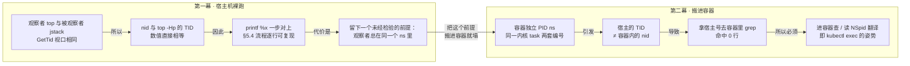

# 05-05 生产环境故障排查实操（故障注入实验室）

> **阶段五·第 5 篇（实战加餐）** | 前置：[05-03-死锁排查与Arthas实战](./05-03-死锁排查与Arthas实战.md) | 后续：[06-01-Redis分布式锁](./06-01-Redis分布式锁.md)
> **建议时长**：5~6 小时（第一幕 3h + 第二幕 2h + 复盘 0.5h）
> 🛠️ **实操篇**：把 05-03 的排查流程搬上一台**真实 Linux 服务器**跑通，再搬进容器，讲透"同一套命令为什么在容器里查不出来"

---

## 📌 优先级导航

| 标记 | 知识点 | 策略 |
|---|---|---|
| 🛠️ ⭐⭐⭐ | 故障注入服务（能常驻/能清理/能反复演练）、jstack 死锁报告两种形态、CPU 飙高全流程 | **能亲手跑通 + 能读报告** |
| 🛠️ ⭐⭐⭐ | **容器 PID 命名空间：`nid` ≠ 宿主 `top -Hp` 的 TID** | **能解释因果 + 能选对齐方案** |
| ⭐⭐⭐ | Arthas `thread -n` / `thread -b` / `trace` / `watch` / `monitor` / `jad` / `sc` | **会实操** |
| ◈◈ | 容器感知（heap 25% / availableProcessors）、`nproc` vs JVM 分歧、CPU 节流 | **知道 + 会算** |
| ○ | 多份 dump 对比、`ps -Lp` 的坑、actuator 辅助手段 | **知道有** |

---

## 0. 造故障速查（先看这里）

> 前提：服务已按 §2.1 起好，且**你在服务器的 ssh 会话里**。
> 端口 `8080` 是第一幕（宿主机裸跑）；第二幕容器映射在 `8081`，把下面 URL 里的 8080 换掉即可。
> 注入用 `POST`、清理用 `DELETE` —— 都是状态变更，别拿浏览器直接点。

| 场景 | 造故障（POST） | 默认参数 | 清理 | 详见 |
|---|---|---|---|---|
| synchronized 死锁 | `/lab/deadlock/sync` | `delayMs=200` | ❌ 只能重启进程 | §3.2 |
| ReentrantLock 死锁 | `/lab/deadlock/lock` | `delayMs=200` | ❌ 只能重启进程 | §3.3 |
| CPU 空转（业务死循环） | `/lab/cpu/burn` | `threads=4&mode=spin` | `DELETE /lab/cpu/burn` | §3.4 |
| CPU 飙高（正则灾难回溯） | `/lab/cpu/burn?mode=regex` | `threads=4` | `DELETE /lab/cpu/burn` | §3.4 / §5.5④ |
| 活锁（无退避） | `/lab/livelock` | `threads=2` | `DELETE /lab/livelock` | §3.5 |
| 活锁修复对照（随机退避） | `/lab/livelock/backoff` | `threads=2` | `DELETE /lab/livelock` | §3.5 |
| 线程池自死锁（资源死锁） | `/lab/pool/self-deadlock` | `poolSize=2&tasks=2` | `DELETE /lab/pool` | §6 坑 1 |
| 线程池耗尽 | `/lab/pool/exhaust` | `poolSize=2&holdMs=60000` | `DELETE /lab/pool` | §3.7 / §6 坑 1 |
| BLOCKED 堆积（`thread -b` 靶子） | `/lab/blocked` | `holders=1&waiters=8` | `DELETE /lab/blocked` | §3.6 |
| 内存泄漏 / GC 风暴 | `/lab/leak` | `mbPerSec=20` | `DELETE /lab/leak` | §5.5② |
| 全部清理 | — | — | `DELETE /lab/all` | §3.11 |

**可直接复制的一整段**：

```bash
# 死锁（清不掉，验证完要重启进程）
curl -X POST localhost:8080/lab/deadlock/sync
curl -X POST localhost:8080/lab/deadlock/lock

# CPU 飙高（spin=业务死循环，regex=正则回溯，两种栈顶长相不同）
curl -X POST "localhost:8080/lab/cpu/burn?threads=4&mode=spin"
curl -X POST "localhost:8080/lab/cpu/burn?threads=4&mode=regex"

# 活锁（backoff 是对照：随机退避后 success 才开始增长）
curl -X POST "localhost:8080/lab/livelock?threads=2"
curl -X POST "localhost:8080/lab/livelock/backoff?threads=2"

# 线程池（self-deadlock：jstack 不报；exhaust：池满，别人的接口也超时）
curl -X POST "localhost:8080/lab/pool/self-deadlock?poolSize=2&tasks=2"
curl -X POST "localhost:8080/lab/pool/exhaust?poolSize=2&holdMs=60000"

# BLOCKED 堆积（Arthas thread -b 的靶子）
curl -X POST "localhost:8080/lab/blocked?holders=1&waiters=8"

# 内存泄漏（到 lab.leak.max-mb=512 自动停手，不会真把服务撑死）
curl -X POST "localhost:8080/lab/leak?mbPerSec=20"

# 清理（死锁除外）
curl -X DELETE localhost:8080/lab/cpu/burn
curl -X DELETE localhost:8080/lab/livelock
curl -X DELETE localhost:8080/lab/pool
curl -X DELETE localhost:8080/lab/blocked
curl -X DELETE localhost:8080/lab/leak
curl -X DELETE localhost:8080/lab/all
```

**不是造故障、但演练常用的四个**：

| 用途 | 命令 |
|---|---|
| 现场确认（`activeFaults` 为空 = 没注进去，别急着 jstack） | `GET /lab/status` |
| 让 ThreadMXBean 立即扫一次 | `POST /lab/detect/now` |
| 造业务流量（Arthas `trace` / `watch` / `monitor` 用） | `GET /lab/biz/order?userId=u1&skuId=88&qty=2&slowMs=0&failRate=0` |
| 走 lab 线程池（池被 `/pool/*` 占满时会超时） | `GET /lab/biz/slow-task?ms=100` |

---

## 1. 为什么需要这个实验室

### 1.1 现有练习代码为什么不能当"线上故障"用

`src/test/java/com/sw/yang/concurrent/pattern/` 下的 `DeadlockDetectTest`、`CpuSpikeTest` 已经是能跑的死锁/CPU 飙高代码了，为什么还要另造一个服务？

**因为它们跑完就退出了。** 这两个测试的线程都是 `setDaemon(true)` + `Thread.sleep` 之后自然结束 —— 打开文件能看到那行注释：*"否则测试结束 JVM 不退出，surefire 会挂住"*。

而线上故障的形态是：

```
长驻（进程一直活着）
  + 无人值守（没人给你机会从第一行开始复现）
  + 难复现（偶发、依赖时序）
```

**排查的前提是"进程卡在那儿不动，等你 attach 上去"**。一个跑完就退出的进程，你连 `jps` 都来不及敲。所以必须先造一个：

> **能常驻、能按需触发、能清理、能反复演练**的故障注入服务。

这不是"顺便加个 demo"，是排查实操的**前提条件**。

### 1.2 从故障形态推出的三条硬约束

| 约束 | 为什么 |
|---|---|
| **注入接口必须立刻返回** | 故障要留在**后台线程**里。否则注入动作本身占死一个 Tomcat worker —— 你还没开始排查，排查工具（HTTP 调 `/lab/status`）先没响应了，等于把"注入故障"变成了"另一个故障" |
| **故障线程用非 daemon** | 生产里死锁的就是这种业务线程。注意 daemon 与否**不影响 jstack 报告内容**（报告只看线程状态与栈），纯粹为保真度 |
| **清理靠协作式中止，不靠 `interrupt()`** | 纯 CPU 空转循环没有任何阻塞点，`interrupt()` 只是置个标志位，循环体不查它就毫无效果；`synchronized` / `lock()` 也不响应中断。所以每个可恢复场景持有一个 `volatile boolean running`，`stop()` 置 false 让循环自然退出 |

**唯一的例外：真死锁在进程内无法清理。** 两个线程互持锁永久阻塞，既不能 interrupt（阻塞在等锁上不响应），也没有循环可被标志位唤醒。这不是缺陷、是教学点 —— 对齐 05-03 §6「死锁只能重启」。所以 `/lab/status` 会把它如实标成 `RESTART_REQUIRED`，而不是假装清理成功。

为了让演练可反复：**死锁用每次注入 `new` 的一对专用锁对象**，绝不碰任何全局单例锁 —— 这样死锁只污染注入出来的那两个线程，`/lab/status` 照常可用。

---

## 2. 部署总览：为什么是两幕



**为什么不能只做一幕**：

- **只做宿主机** → 你会以为 `top -Hp` → `printf %x` → `jstack | grep 0x<hex>` 是放之四海皆准的。它不是。这套流程**默认了"观察者和被观察者在同一个 PID 命名空间"**，而这个前提在容器里不成立。
- **只做容器** → 容器里同时叠了命名空间、cgroup 限额、镜像工具缺失三层干扰，你会分不清"这条命令失败"到底怪哪一层。

所以：**第一幕把文档流程跑到肌肉记忆，第二幕专门打掉那个隐含前提。** 第二幕最大的价值不是"又跑了一遍"，而是让你以后在 K8s 里排查时，第一反应是"先确认我在哪个命名空间里看"。

### 2.1 服务器与产物清单

> **术语约定**：本篇的「**宿主机**」一律是**相对容器**说的，即跑 Docker 的那台 Ubuntu 服务器本人。请注意它和「宿主机**命名空间**」（§4.3）不是一回事 —— 前者说的是**机器**（vs 容器镜像），后者说的是**最外层那个 PID namespace**（vs 容器 namespace）。两者恰好都落在这台服务器上，容易读串。

| 项 | 值 |
|---|---|
| 服务器 | Ubuntu 22.04 / 4 核 / 3.6G 内存 / 31G 可用 |
| 登录 | `ssh tencent-docker`（别名在 `~/.ssh/config`，用户 `ubuntu`） |
| 宿主机 JDK | `openjdk-17-jdk-headless`（**服务器原本没有 java**，`jps`/`jstack` 都要装） |
| 容器镜像 | `eclipse-temurin:17-jdk-jammy` + 内置 Arthas |
| 服务器产物 | `~/lab/{app.jar, arthas-boot.jar, start.sh, logs/, dumps/}` |

**一切都在服务器上做。** 本地开发机在这整套里只承担两件事，而且都只做一次：

| 本地机器只干这个 | 什么时候需要 |
|---|---|
| `provision`：装 JDK17 + 下 Arthas 到服务器 | 首次，一次性 |
| `build`：`mvn package` 出 fat jar，scp 上传 | **只有改了 Java 代码才需要** |

```bash
# 在本地（Git Bash）跑，仅这两条
bash scripts/lab/lab.sh provision
bash scripts/lab/lab.sh build
```

**除此之外的一切都在服务器上**。`ssh` 进去，后面全是原始命令：

```bash
ssh tencent-docker
```

**起服务** —— 服务器上有个 `~/lab/start.sh`（由 `lab.sh build` 一起传上去的）：

```bash
bash ~/lab/start.sh
```

它做的就是下面这**一条** `nohup java`，没有任何玄机 —— 加上"已经在跑就拒绝重复起"和"等服务真在监听才算成功"两件事：

```bash
nohup java -jar ~/lab/app.jar --lab.enabled=true --server.address=127.0.0.1 > ~/lab/logs/console.log 2>&1 &
```

两个 flag 各管一件事：`--lab.enabled=true` 是**必须**的（默认关，不加则 `/lab/**` 全 404）；`--server.address=127.0.0.1` 只绑 loopback（安全）。日志被 `> ~/lab/logs/console.log` 接住了，`tail -f ~/lab/logs/console.log` 就能看。

> 想看网页版 threaddump（§2.2）就再加一个 flag，默认只暴露 health：
> `--management.endpoints.web.exposure.include=health,threaddump,heapdump,metrics`

**停服务** —— 先自己找进程，再 kill：

```bash
jps -l
kill <pid>
```

（**刻意不配 stop 脚本**：就两条命令，而且 `jps` 本来就是排查第一步，这个环节留着让你敲。同理不写 pid 文件 —— 能自己找就别让文件替你做。）

**排查动作全部手敲**（§3 / §4 给的都是原始命令）。**不要**把它们包成脚本 —— `jstack` / `top -Hp` / `printf %x` / Arthas 正是要练的东西，包起来就等于把练习内容藏了。而且线上排查第一步永远是 `jps` / `top` 自己找进程，这个环节不能被跳过。

> **本文档的命令约定**：凡是命令，都假设你**已经在服务器上的 ssh 会话里**，所以直接写 `jstack -l <pid>`，不套 `ssh host '...'`。`8080` 是服务在服务器上绑的 loopback 端口，所以 `curl localhost:8080/...` 也是在会话里敲。

> **代码块约定**（照这个来就不会复制错）：
> - **带 `bash` 标记的块里只有命令，可以整段复制粘贴**。行首**不带** `$` 提示符 —— 那个符号会被 shell 当成命令，报 `$: command not found`。
> - **命令的输出单独放在紧跟其后的普通代码块里**，通常前面有一句"输出："。
> - **输出不要粘进终端** —— 它不是命令，粘进去会报 `command not found`（比如把 `3714998 /home/ubuntu/lab/app.jar` 当命令执行）。

> **⚠️ 示例输出里的这些值每次都不一样，绝对不能照抄**（抄了会像"搜不到""连不上"，让人怀疑工具坏了）：
>
> | 值 | 为什么变 | 例子 |
> |---|---|---|
> | 线程名里的编号 | 注入计数器自增，每注入一次 +1 | `deadlock-lock-**2**-T1`（你可能是 `-1-`） |
> | `pid` | 每次启动都变 | `3714998` |
> | 内存地址 | 每次运行都不同 | `0x00007f7dd00016e0` |
> | `tid` / `nid` | 每次运行都不同 | `nid=0x38acc1` |
>
> **规则：`bash` 块可以照抄，示例输出只能对照着看。**
>
> 找线程段时别照抄线程名，用**不依赖编号**的正则（`less` 的搜索也支持正则）：
>
> ```bash
> grep -nE '"deadlock-lock-[0-9]+-T[12]" #' ~/lab/dumps/002.txt
> ```
>
> —— 靠的是线程段独有的 `" #数字` 指纹（报告段里永远只有 `"名字":`）。

#### 三类命令：看标签就知道是不是要练的

从 §3 开始，每个代码块都带标签。**只有「排查」那一类是需要练的技能，其余两类是手段**：

| 标签 | 是什么 | 常见命令 | 要练吗 |
|---|---|---|---|
| **造故障** | 通过 `/lab/**` 接口把故障注入进去 | `curl -X POST localhost:8080/lab/...` | ❌ 手段，敲一次就行 |
| **清故障** | 把故障撤掉 | `curl -X DELETE localhost:8080/lab/...` | ❌ 同上 |
| **排查** | **真正的诊断动作** | `jps` `jstack` `top -Hp` `printf %x` Arthas | ✅✅ **这才是要练的** |
| **部署** | 起停进程、容器 | `bash ~/lab/start.sh` `kill` `docker compose` | ❌ 一次性动作 |

**为什么要分**：排查时你面对的是一台有故障的机器 + 一堆工具，**第一步永远是"用 `jps`/`top` 找到目标"**，而不是先想"我该敲哪个脚本"。把「造故障」和「排查」混在一个代码块里，读的时候会分不清哪个才是要学的 —— 这是本文档之前的毛病，现在标开。

> **⚠️ 必须在 Git Bash 里跑本地那两条命令，不要在 PowerShell / CMD 里跑**：PowerShell 的 `bash` 会走到 WSL（`C:\Windows\System32\bash.exe`），而 WSL 的 `$HOME` 下没有 Windows 的 `~/.ssh/config`，`tencent-docker` 这个别名解析不了，只会报一句 `Could not resolve hostname` —— 看着像网络问题，其实是跑错 shell 了。（`lab.sh` 现在会先探测并给出提示。）

### 2.2 安全：默认关 + 双保险

`/lab/**` 是**能打死服务**的接口，所以：

1. **默认关**：`lab.enabled=false`（写在 `application.properties` 里，可审计）。lab 包下所有 bean 都挂 `@ConditionalOnProperty(lab.enabled=true)`，默认**连 Controller 都不注册**，访问 `/lab/**` 直接 **404**。启动时用命令行 `--lab.enabled=true` 显式打开 —— 这样每次启动日志里都留得下"这次开了 lab"的证据，演练完重启即恢复安全态，不依赖人记得改回来。
2. **不暴露**：宿主机 `--server.address=127.0.0.1`；容器 `-p 127.0.0.1:8081:8080`。公网/安全组**不开端口**。想用浏览器看，就在**本机**开 ssh 隧道：

   ```bash
   ssh -N -L 18080:127.0.0.1:8080 tencent-docker
   # 然后浏览器打开 http://127.0.0.1:18080/lab/status
   #            http://127.0.0.1:18080/actuator/threaddump
   ```

服务器实测（不带 `--lab.enabled=true` 启动）：

```
启动横幅里有 LAB MODE 吗： 0 行（期望 0）
  /lab/status        → HTTP 404
  /lab/cpu/burn      → HTTP 404
  /lab/anything      → HTTP 404
  /actuator/health   → HTTP 200
  /actuator/threaddump → HTTP 404    ← 默认只暴露 health
```

---

## 3. 第一幕：宿主机裸跑

### 3.0 进 Arthas：交互模式（建议先读）

> 从 §3.4 起会反复用到 Arthas。文档示例统一写成
> `java -jar arthas-boot.jar <pid> -c "<命令>"`，是为了让"一条命令 + 一段输出"能对上号。
> 但自己排查时**推荐交互模式**：attach 一次，后面换着命令敲。两种入口底层完全一样。

**两种入口，同一件事**：

```text
java -jar arthas-boot.jar
  → 它本身是个 JVM 进程，像 jps 一样枚举本机 JVM
  → 通过 JDK Attach API 把 arthas-agent 注入目标 JVM
  → agent 在【目标进程内】启动 server（telnet 3658 / http 8563）
  → 提示符 [arthas@<pid>$] 只是客户端连到了目标进程里的 server
```

| | 交互模式 | 一条命令（`-c`） |
|---|---|---|
| 启动 | `java -jar ~/lab/arthas-boot.jar`（选序号）<br>或 `... <pid>`（跳过菜单） | `java -jar ~/lab/arthas-boot.jar <pid> -c "<命令>"` |
| attach 次数 | 一次 | 每条命令 attach 一次 |
| 适合 | 探索、反复换命令 | 文档示例、脚本、定时采集 |
| 退出 | `quit` / `q` 退客户端（agent 仍在）；`stop` 停掉 Arthas server | 命令执行完自动退出客户端 |

**上手**：

```bash
# <pid> 用 jps -l 找，见 §3.1
java -jar ~/lab/arthas-boot.jar
# 会列出本机 Java 进程，输入序号回车；也可以直接指定 pid 跳过菜单：
java -jar ~/lab/arthas-boot.jar <pid>
```

进去之后（下面是**交互记录**，`[arthas@...]$` 是提示符，**不要连着提示符一起粘进终端**）：

```
[arthas@3714998]$ thread -n 3
...
[arthas@3714998]$ thread -b
...
[arthas@3714998]$ trace com.sw.yang.concurrent.lab.OrderService createOrder
...
[arthas@3714998]$ watch com.sw.yang.concurrent.lab.OrderService createOrder '{params, returnObj}' -n 3
...
[arthas@3714998]$ quit      # 只退客户端，agent 还留在目标进程里
```

**三个必须知道的点**：

1. **流式命令要自己限次数**：`watch` / `trace` / `monitor` 默认会一直挂着等事件 —— 交互里用 `Ctrl-C` 停；写成 `-c` 一条命令时**必须**加 `-n`（如 `watch ... -n 3`），否则会一直等到 session 超时。`dashboard` 是实时面板，别用 `-c`。
2. **`quit` ≠ `stop`**：`quit` / `exit` / `q` 只断开当前客户端，Arthas agent 仍在目标进程里；`stop` 才是把 Arthas server 停掉。
3. **容器里要先进容器再 attach**：`docker exec -it ...`，宿主侧 attach 枚举不到容器 PID 命名空间里的进程（§4.5）。

> 为什么文档示例统一用 `-c`：每个小节要的是"一条命令 → 一段确定的输出"，能复制、能复现、能对上号；交互模式的时间线会混入多条命令和多次 `Ctrl-C`，不适合当示例。**练的时候用交互模式，对输出时用 `-c`。**

### 3.1 准备 & 基线

装 JDK（**服务器原本没有 java**，`jps`/`jstack` 都要靠它）和 Arthas 是本地那一次 `provision` 干的事，服务器上看结果：

```
java -version
openjdk version "17.0.20.1" 2026-08-18
command -v jps jstack
/usr/bin/jps
/usr/bin/jstack
```

起服务（`bash ~/lab/start.sh`，见 §2.1），它会打出**三个基线数字**，第二幕要和它们逐个对照：

```
tail -20 ~/lab/logs/console.log
...
  ⚠️  LAB MODE：故障注入接口已激活（/lab/**）
  pid                        = 3714998
  availableProcessors        = 4
  maxHeap                    = 930 MB
  jvmArgs                    = (无显式参数)
```

**为什么记这三个数**：它们反映"JVM 以为自己跑在什么样的机器上"。裸跑时它看到的是**物理机** —— 4 核、堆 = 3.6G 的 25% ≈ 930MB、pid 是个普通的宿主 pid。第二幕同一份 jar 会给出**完全不同的三个数**。

服务起来之后，**先自己找一遍进程** —— 这是每次排查的第一步，练成肌肉记忆：

```bash
jps -l
```

输出：

```
3714998 /home/ubuntu/lab/app.jar
```

后面所有排查命令里的 `<pid>` 就是它（每次启动都不同，别记死）。

### 3.2 synchronized 死锁：jstack 报告逐行读

**造故障** —— 打接口注入一个死锁：

```bash
curl -X POST localhost:8080/lab/deadlock/sync
```

返回：

```
{"injected":"deadlock/sync","id":"deadlock-sync-1","threads":["deadlock-sync-1-T1","deadlock-sync-1-T2"],
 "cleanup":"RESTART_REQUIRED","hint":"jstack -l <pid> 找 'Found one Java-level deadlock'；清理需重启进程"}
```

**⚠️ 抓之前先自检** —— 这两条是**习惯，不是可选项**：

```bash
jps -l
curl -s localhost:8080/lab/status | grep -o '"activeFaults":\[[^]]*\]'
```

输出：

```
4105743 /home/ubuntu/lab/app.jar
"activeFaults":[{"id":"deadlock-sync-1","type":"deadlock/sync", ...
```

**`activeFaults` 是空的就说明故障没注入成功，别往下抓** —— 你会得到一份干净的栈，然后误以为"jstack 抓不到死锁"。

> 线上同理：接到"接口全超时"别直接冲上去 `jstack`，**先确认症状可见**（接口真的在挂？CPU 真的高？）。抓到一份干净的栈时，第一反应应该是"我的观察窗口对不对"，而不是"工具不好使"。
>
> **别学错**：抓不到有两种原因，现象一样、原因完全不同 ——
> - **故障根本没注入**（本节的坑）→ 先自检 `activeFaults`
> - **注入了但抓的时机不对** → jstack 是瞬时快照，要在 §3.6 那样隔几秒抓多份

**排查** —— 自检过了，现在抓线程栈。这才是要练的动作：先 `jps` 找进程，再 `jstack` 抓，然后**自己读**：

```bash
jps -l
jstack -l 3714998 > ~/lab/dumps/act1-sync.txt
less ~/lab/dumps/act1-sync.txt      # 进去按 / 键搜 "Found"
```

`jps -l` 的输出就是上面那个 pid，`jstack` 和 `less` 没有终端输出（一个写进了文件，一个进了分页界面）。

> **`less` 是分页查看器**（一份 dump 实测 438 行，`cat` 会一口气刷满屏，滚上去就没法搜了）。里面的键和 vim 同一套，注意**这些是"按的键"，不是要打进去的字**：
>
> | 按键 | 作用 |
> |---|---|
> | `/` 然后输入 `Found` 再回车 | 向下搜索。**`/` 本身是个按键** —— 按下去底部会出现一个 `/` 等你输入关键字 |
> | `n` / `N` | 跳到下一个 / 上一个匹配（不用重输关键字） |
> | `G`（Shift + g） | 跳到文件末尾 |
> | `g` `g`（连按两下） | 跳到文件开头 |
> | `q` | 退出 |
>
> **为什么在 `less` 里搜而不是 `grep`**：`grep Found dump.txt` 只给一堆**没有上下文的匹配行**；`less` 里用 `n` 跳到匹配点后，**前后几十上百行都还在** —— 排查死锁恰恰要顺着栈往上读调用链、往下读"谁持有着锁"。这是 `less` 不可替代的地方。

#### `jstack` 那个 `-l` 到底加什么（实测）

网上（和本文档的早期版本）常说"死锁检测要靠 `-l`"。**实测下来这是错的** —— 在本实验室的 JDK 17.0.20.1 上，synchronized 和 ReentrantLock 两种死锁，加不加 `-l` **都报**。

`-l`（long）真正加的只有一样东西：**每个线程"持有哪些 AQS 锁"**。同一个线程（ReentrantLock 死锁里的 T1）对比：

```
不加 -l：                   加 -l：
  ...栈帧...                  ...栈帧...
  - parking to wait for <0x…>    - parking to wait for <0x…>      ← 在等谁（两边都有）
  （到此结束）                 
                             Locked ownable synchronizers:
                                - <0x00000000c7ca1280> (…Lock)   ← 攥着谁（只有 -l 有）
```

| 信息 | 不加 `-l` | 加 `-l` |
|---|---|---|
| 死锁报告（两种锁都算） | ✅ | ✅ |
| monitor 锁的等 / 持有（`- waiting to lock` / `- locked`） | ✅ | ✅ |
| AQS 锁的**等待**（`- parking to wait for`） | ✅ | ✅ |
| **AQS 锁的持有**（`Locked ownable synchronizers`） | ❌ | ✅ |

**那为什么还要加 `-l`**：死锁报告会替你把环画出来，所以有报告时 `-l` 确实可有可无。但**没有报告的那些场景** —— §3.6 的 BLOCKED 堆积、锁竞争、活锁排查 —— 你得自己拼"谁在等谁、谁又攥着谁"。而：

- `synchronized` 的持有关系（`- locked <0x…>`）**内联在栈里，一直都在**；
- **AQS 系锁（ReentrantLock / ReentrantReadWriteLock / Semaphore）的持有关系，只有 `-l` 才给。**

所以结论：**养成加 `-l` 的习惯**。代价只是输出长一点（实测 438 行 → 537 行）。

> 顺带解释一下"为什么注入用 `POST`、清理用 `DELETE`"：它们是**状态变更** —— 注入会在后台留下常驻线程，清理会真的把线程停掉。用 GET 既不达意，也可能被浏览器/代理预取误触发。

真实输出（JDK 17 / Linux）：

```
Found one Java-level deadlock:
=============================
"deadlock-sync-1-T1":
  waiting to lock monitor 0x00007f7dd00016e0 (object 0x00000000c7a75878, a java.lang.Object),
  which is held by "deadlock-sync-1-T2"

"deadlock-sync-1-T2":
  waiting to lock monitor 0x00007f7dcc006000 (object 0x00000000c7a75868, a java.lang.Object),
  which is held by "deadlock-sync-1-T1"

Java stack information for the threads listed above:
===================================================
"deadlock-sync-1-T1":
	at com.sw.yang.concurrent.lab.DeadlockScenarios.lambda$inject$0(DeadlockScenarios.java:87)
	- waiting to lock <0x00000000c7a75878> (a java.lang.Object)
	- locked <0x00000000c7a75868> (a java.lang.Object)
	...
"deadlock-sync-1-T2":
	at com.sw.yang.concurrent.lab.DeadlockScenarios.lambda$inject$1(DeadlockScenarios.java:112)
	- waiting to lock <0x00000000c7a75868> (a java.lang.Object)
	- locked <0x00000000c7a75878> (a java.lang.Object)

Found 1 deadlock.
```

**解读要点**（对应 05-03 §2.2）：

- `waiting to lock ... which is held by` → **谁在等谁的锁**，这是死锁报告的核心信息，一眼就能画出环
- 两个 `<0x...>` 地址**交叉对应**：T1 的 `waiting` = T2 的 `locked`，反之亦然 —— 这就是"循环等待"的物证
- `- waiting to lock` = 正在等（**没有**持有）；`- locked` = 已持有。这两个词看反了就会把结论搞反

线程段本身（同一份 dump 里）：

```
"deadlock-sync-1-T1" #35 ... nid=0x38acc1 waiting for monitor entry
   java.lang.Thread.State: BLOCKED (on object monitor)
	at com.sw.yang.concurrent.lab.DeadlockScenarios.lambda$inject$0(DeadlockScenarios.java:87)
	- waiting to lock <0x00000000c7a75878> (a java.lang.Object)
	- locked <0x00000000c7a75868> (a java.lang.Object)
```

`waiting for monitor entry` + `BLOCKED (on object monitor)` —— 记住这一对，它是 synchronized 死锁的指纹。**记下 `nid=0x38acc1`，第二幕要用它做对照。**

#### 一个容易被误判的现象：日志静默

内置的 `DeadlockDetector`（对应 05-03 §4）默认每 10s 扫一次，会**主动喊**：

```
ERROR ... [lab-deadlock-detector] DeadlockDetector : [lab] ⚠️ 检测到死锁！涉及 2 个线程：[deadlock-sync-1-T1, deadlock-sync-1-T2]
ERROR ... [lab-deadlock-detector] DeadlockDetector : [lab]    - deadlock-sync-1-T1 [BLOCKED] 等待 java.lang.Object@4ae5c2ea（持有者 deadlock-sync-1-T2）栈顶 ...DeadlockScenarios.lambda$inject$0(DeadlockScenarios.java:87)
```

但**如果关掉它**（起服务时把 `--lab.detector.enabled=false` 加到那条 `nohup java` 后面），日志会完全静默：

```
注入前总行数: 62
25s 后总行数: 62  → 新增 0 行
✅ 日志完全静默 —— 服务已死锁，但日志一个字都没写
```

**这就是最常见的一种误判**："日志没报错，说明服务没出问题"。真相是：死锁的线程**没有在打日志**（它根本没在跑），而活着的线程（Tomcat worker）**也没有理由打日志**（它们只是闲着等请求）。

> **日志静默 ≠ 无活动；日志静默只说明"没有阻塞式 IO 在打日志"。**
> 这两件事的因果是分开的 —— 一个检测器（比如 §4 的 ThreadMXBean 定时任务）恰恰就是为了补上这个盲区。

### 3.3 ReentrantLock 死锁：与 synchronized 的形态差异（**实测修正 05-03 §6 坑 1**）

05-03 §6 坑 1 说：

> 现代 JDK（6+）的 deadlock 检测通过 ownable synchronizers 机制 → jstack 对标准 ReentrantLock 死锁也会输出 "Found one Java-level deadlock"，不是只能检测 synchronized

**这条结论是对的**（本次在 Linux JDK 17.0.20.1 上实测确认），但原文没讲清**报告长什么样**，而这恰恰是排查时最需要的。

> **先分清一份 dump 的两个部分** —— 很多人第一次读会混：
>
> | | **线程段**（文件主体） | **死锁报告段**（文件末尾） |
> |---|---|---|
> | 位置 | 从 `Full thread dump …` 到 `JNI global refs: …` | `JNI global refs:` 之后到文件结束 |
> | 线程名后面跟什么 | `#35 prio=5 os_prio=0 … tid=0x… **nid=0x3ec2c5** waiting on condition` | **只有一个 `:`** |
> | 有 `Thread.State` 行吗 | ✅ | ❌ |
> | 有 `Locked ownable synchronizers` 段吗 | ✅（加 `-l` 才有） | ❌ |
> | 本质 | **原始数据**：每个线程自己长啥样 | **JVM 的结论**：谁和谁成环 |
>
> 实测一份 509 行的 dump：**线程段占第 16~469 行（31 个）**，报告段只有第 473~508 行。
>
> **两段都得会读，别只盯报告段** —— 报告段是"快"，但它**只在 JVM 认得出来的死锁里才有**；线程段是"全"，它永远在。后面要练的**活锁**（§3.5）、**BLOCKED 堆积**（§3.6）、**线程池饥饿**（§4 的坑）**全都没有报告段**，只能从线程段里自己读。只盯报告段的人，遇到"没有 Found 的故障"就瞎了。
>
> **怎么从报告段跳到线程段**：把报告里的线程名拿去搜，但要加上线程段独有的 `" #` 指纹，否则会命中报告段里同名的好几处。别照抄编号（那是自增的），用正则：
>
> ```bash
> grep -nE '"deadlock-lock-[0-9]+-T[12]" #' ~/lab/dumps/act1-lock.txt
> ```
>
> 输出就是那两行线程段。或者在 `less` 里搜同样的正则，跳过去后能顺带看到 `nid`、`Thread.State`、`Locked ownable synchronizers` 这些**报告段没有**的信息。

**造故障** —— 换 ReentrantLock 版本，其余一样（还是两把锁，只是拿锁顺序相反）：

```bash
curl -X POST localhost:8080/lab/deadlock/lock
```

**排查** —— 同样 `jstack -l` + `less`，但**报告的措辞和线程状态全变了**，这才是本节的重点：

```bash
jstack -l <pid> > ~/lab/dumps/act1-lock.txt
less ~/lab/dumps/act1-lock.txt      # 按 / 搜 Found，跳到文件末尾那段报告
```

> **别用 `grep -A3 'ownable synchronizer'` 去抓报告** —— 这个关键词在文件里出现三十多次（每个持有 AQS 锁的线程都有一段 `Locked ownable synchronizers`），`grep -A3` 会把它们和报告里的匹配**片段化地混在一起**，看起来像一堆残缺的报告。要看报告就用 `less` 搜 `Found`，那是完整的一段。

（如果 §3.2 注入的 synchronized 死锁还没清掉，这份 dump 里会同时有两个死锁，末尾显示 `Found 2 deadlocks.` —— 想干净对照就先重启进程，见 §3.5 的做法。）

```
Found one Java-level deadlock:
=============================
"deadlock-lock-2-T1":
  waiting for ownable synchronizer 0x00000000c796ae28, (a java.util.concurrent.locks.ReentrantLock$NonfairSync),
  which is held by "deadlock-lock-2-T2"
```

线程段：

```
"deadlock-lock-2-T1" #37 ... nid=0x38b146 waiting on condition
   java.lang.Thread.State: WAITING (parking)
	at jdk.internal.misc.Unsafe.park(java.base@17.0.20.1/Native Method)
	- parking to wait for  <0x00000000c796ae28> (a java.util.concurrent.locks.ReentrantLock$NonfairSync)
	at java.util.concurrent.locks.LockSupport.park(LockSupport.java:211)
	at java.util.concurrent.locks.AbstractQueuedSynchronizer.acquire(AbstractQueuedSynchronizer.java:715)
	at java.util.concurrent.locks.AbstractQueuedSynchronizer.acquire(AbstractQueuedSynchronizer.java:938)
	at java.util.concurrent.locks.ReentrantLock$Sync.lock(ReentrantLock.java:153)
	at com.sw.yang.concurrent.lab.DeadlockScenarios.lambda$inject$0(DeadlockScenarios.java:73)

   Locked ownable synchronizers:
	- <0x00000000c796adf8> (a java.util.concurrent.locks.ReentrantLock$NonfairSync)
```

**两种死锁的指纹对照表**（这张表才是排查时真正要背的）：

| | synchronized 死锁 | ReentrantLock 死锁 |
|---|---|---|
| 报告措辞 | `waiting to lock **monitor** ...` | `waiting for **ownable synchronizer** ...` |
| 线程状态 | `BLOCKED (on object monitor)` | `WAITING (parking)` |
| 线程段首行 | `waiting for monitor entry` | `waiting on condition` |
| 栈顶 | 业务方法（直接卡在 `monitorenter`） | `Unsafe.park` ← `LockSupport.park` ← `AQS.acquire` ← `ReentrantLock.lock` |
| 已持有的锁 | `- locked <0x...>` | `Locked ownable synchronizers: - <0x...>` |

**为什么会有这个差别（因果链）**：`synchronized` 等的是 JVM 的**对象监视器**，被阻塞的线程由 JVM 直接挂起 → 状态是 `BLOCKED`。而 `ReentrantLock` 是在 Java 层用 AQS + `LockSupport.park()` 实现的 —— 线程是被 `park()` 挂起的，JVM 只知道它"在等一个条件"，所以状态是 `WAITING (parking)`。AQS 为了让 jstack 能看见自己，会把锁注册成 **ownable synchronizer**，于是报告里换了套措辞。

**这个差别在排查上的实际影响**：如果只 grep 关键字 `BLOCKED` 来找死锁，**ReentrantLock 死锁会被漏掉**。要么直接搜 `Found.*deadlock`，要么同时看 `BLOCKED` 和 `WAITING (parking)`。

**多个死锁会一起报**：同一份 dump 里同时存在两种死锁时：

```
Found one Java-level deadlock:      ← 第 1 个
...
Found one Java-level deadlock:      ← 第 2 个
...
Found 2 deadlocks.
```

注意开头是 `Found one ...` 重复两次，**末尾**才是 `Found N deadlocks.` 总数 —— 只看开头容易以为只有一个。

### 3.4 CPU 飙高排查全流程（05-03 §5.4）

**造故障** —— 造 4 个 CPU 空转线程：

```bash
curl -X POST "localhost:8080/lab/cpu/burn?threads=4"
```

（`threads` 会被 `lab.cpu.max-threads=4` 截断 —— 服务器只有 4 核，不设上限的话手滑传个 100 会把整台机器打死，连 attach 排查的机会都没有。）

**以下 ①~⑤ 全是「排查」** —— 这就是线上 CPU 飙高的标准动作，值得背下来：

**① 找 CPU 最高的进程**（`top -c`）：

```
    PID USER      PR  NI    VIRT    RES    SHR S  %CPU  %MEM     TIME+ COMMAND
3714998 ubuntu    20   0 4643536 192616  23980 S 375.0   5.1   0:41.65 java
```

**② 找进程内 CPU 最高的线程**（`top -Hp <pid>`）：

```
3715574 ubuntu    20   0 4643536 192616  23980 R  99.9   5.1   0:19.92 lab-cpu+
3715572 ubuntu    20   0 4643536 192616  23980 R  99.9   5.1   0:19.73 lab-cpu+
3715571 ubuntu    20   0 4643536 192616  23980 R  99.9   5.1   0:19.86 lab-cpu+
3715573 ubuntu    20   0 4643536 192616  23980 R  93.3   5.1   0:19.78 lab-cpu+
3715399 ubuntu    20   0 4643536 192616  23980 S   0.0   5.1   0:00.00 deadloc+   ← 死锁线程，0% CPU
```

（4 核机器上 java 375%，4 个线程各 ~100%。注意**死锁线程是 0% CPU** —— 卡住的东西不烧 CPU，烧 CPU 的另有其人。这两类故障的排查入口完全不同。）

> **⚠️ 对 05-03 §5.4 的修正**：文档给的备选命令 `ps -Lp <pid> -o pid,tid,pcpu,comm | sort -k3 -rn` **几乎没用**。实测它输出的是**线程生命周期内的 CPU 均值**，不是瞬时值：
> ```
> 3714998 3714998  0.0 java
> 3714998 3715002  4.0 java
> 3714998 3715004  0.0 GC Thread#0     ← 正在飙的线程也显示 0.0
> ```
> 对"刚刚才开始飙高"的热点，均值会被生命周期稀释到接近 0。**要瞬时值就用 `top -Hp`**。

**③ 转十六进制**（`jstack` 里的 `nid` 是十六进制，所以要先转）：

```bash
printf "%x\n" 3715574
```

输出：

```
38b1f6
```

**④ jstack 定位代码**：

```bash
jstack <pid> | grep -A 30 "0x38b1f6"
```

输出：

```
"lab-cpu-spin-3" #42 ... nid=0x38b1f6 runnable
   java.lang.Thread.State: RUNNABLE
	at com.sw.yang.concurrent.lab.CpuScenarios.burnLoop(CpuScenarios.java:136)
	at com.sw.yang.concurrent.lab.CpuScenarios.lambda$burn$0(CpuScenarios.java:70)
```

**⑤ Arthas：从启动到退出的完整流程**（替代 ②③④，生产上就是这么用）

> ②③④ 是"没有 Arthas 也能查"的手工路径；人在机器前排查时，通常直接用 Arthas 一步到位。
> 下面是**完整的一次会话**：找进程 → 启动 → 选中 → 敲命令 → 退出 → 确认收尾。
> 示例输出里的 pid、序号、线程 Id 每次都不同，**只对照格式，不要照抄数字**。

**第 1 步：找目标进程**

```bash
jps -l
```

输出（`jps` 自己那一行忽略）：

```
3714998 /home/ubuntu/lab/app.jar
3720111 jdk.jcmd/sun.tools.jps.Jps
```

记下 `3714998`。如果列表里**看不到业务进程**，先查三件事：是不是用别的用户跑的（`ps -ef | grep java`）、进程是不是已经死了、目标环境是不是 JRE（JRE 没有 `jps`）。

**第 2 步：启动 Arthas**

```bash
java -jar ~/lab/arthas-boot.jar
```

输出（示例，序号以实际为准）：

```
[INFO] arthas-boot version: 4.x.x
[INFO] Found existing java process, please choose one and input the serial number of the process, eg : 1. Then hit ENTER.
* [1]: 3714998 /home/ubuntu/lab/app.jar
  [2]: 3720111 jdk.jcmd/sun.tools.jps.Jps
```

**第 3 步：选中进程**

输入 `1` 回车 —— **只输序号，不要输整行进程信息**：

```
1
[INFO] arthas home: /home/ubuntu/.arthas/lib/...
[INFO] Try to attach process 3714998
[INFO] Attach process 3714998 success.
...
[arthas@3714998]$
```

看到 `Attach ... success.` + `[arthas@3714998]$` 提示符，才算真正连上。没有提示符就是没连上：

- `AttachNotSupportedException` / `no such process` → 换成**和目标是同一个用户**（或 root）启动 Arthas；目标 JVM 是 JRE 也会失败
- 卡住不动 → 目标机可能禁了 attach；容器场景要先 `docker exec -it` 进容器再 attach（§4.5）

**第 4 步：在提示符里敲诊断命令**

下面是交互记录（`[arthas@...]$` 是提示符，**不要连着提示符一起粘**）：

```
[arthas@3714998]$ thread -n 3
"lab-cpu-spin-0" Id=39 cpuUsage=96.4% deltaTime=193ms time=33509ms RUNNABLE
    at com.sw.yang.concurrent.lab.CpuScenarios.burnLoop(CpuScenarios.java:136)
    at com.sw.yang.concurrent.lab.CpuScenarios.lambda$burn$0(CpuScenarios.java:70)
...
"lab-cpu-spin-2" Id=41 cpuUsage=96.06% ...
```

怎么用这几行：

- `cpuUsage` 最高的就是热点线程，栈顶 `burnLoop` 直接指出问题代码 —— **②③④ 三步省了**
- 记下 `Id=39`，想看某个线程的完整栈，**在同一个提示符里**继续敲 `thread 39`（交互模式用 `Id`，不是 `nid`，不需要 `printf %x`）
- 顺手再敲 `thread -b` 确认有没有"持有锁卡住别人"的线程；`dashboard` 看整体 CPU/GC（按 `q` 或 `Ctrl-C` 退出面板，回到提示符）
- 一条命令结束后**提示符还在**，可以一直换命令，不用重新 attach

**第 5 步：退出**

```
[arthas@3714998]$ quit
```

`quit` 只是断开客户端，**agent 还留在目标 JVM 里**。如果本次用过 `watch` / `trace` 这类会增强字节码的命令，生产上建议用：

```
[arthas@3714998]$ stop
```

`stop` 会停掉 Arthas server 并**重置所有被增强的类**；`quit` 不会。

**第 6 步：确认收尾**

```bash
jps -l
```

目标进程还在（pid 没变），就说明这次排查没有影响业务。

> **生产上还要注意**：
> - Arthas 的 jar 必须在**目标机器上**（没外网就提前放好，路径按你公司的来，示例里是实验室的 `~/lab/arthas-boot.jar`）
> - 必须能走 JDK 的 attach：同用户或 root；**JRE 上 attach 不了**
> - 默认会开 telnet 3658 / http 8563，只绑 loopback，别对公网/安全组开放
> - 终端不能交互时（CI、部分 `kubectl exec`），退回一条命令模式：`java -jar arthas-boot.jar <pid> -c "thread -n 3"`；流式命令记得加 `-n`（见 §3.0）

> 为什么文档示例里常常只写 `-c`：那是为了"一条命令对应一段确定输出"，方便复制和对照。**真排查时用交互模式** —— attach 一次，`thread -n` / `thread <id>` / `thread -b` / `dashboard` 连续换着看，比反复 attach 顺手得多。

### 3.5 活锁：jstack 抓不到的边界（05-03 §3.1 + §6 坑 1①）

这是本实验室最值得亲手做一次的对照实验。为了结论干净，**必须在只有活锁的进程里测**。

**部署** —— 清空现场，重启一个干净的进程：

```bash
jps -l && kill <pid>             # 停掉
bash ~/lab/start.sh              # 重新起
jps -l                           # pid 变了，重新找
```

**造故障** —— 只注入活锁，别的不加：

```bash
curl -X POST "localhost:8080/lab/livelock?threads=2"
```

**排查** —— 抓栈，看它报不报死锁：

```bash
jstack -l <pid> | grep -c 'Found.*deadlock'
jstack -l <pid> > ~/lab/dumps/act1-livelock.txt
```

输出：

```
0                                    ← 关键：一条都不报
```

（为什么要"干净"：如果进程里还残留着之前注入的真死锁，grep 会把**那些**报出来，看起来像"活锁也被检测到了"。我第一次就踩了这个 —— 排查里最忌讳的就是没控制变量的实验。）

| 检测手段 | 活锁的结果 |
|---|---|
| `jstack -l` 有多少条死锁报告 | **0** |
| `ThreadMXBean.findDeadlockedThreads()` | **`{"deadlocked":false,"threads":[]}`** |
| Arthas `thread -b` | **找不到阻塞者**（没谁卡住谁） |
| Arthas `thread -n 3` | **两个 RUNNABLE 热点**，栈顶在 `tryAcquireBoth` |
| 线程状态 | 一个 `RUNNABLE` 在 `tryAcquireBoth` 里空转，一个短暂 `TIMED_WAITING` |

```
"lab-livelock-0" #35 ... nid=0x38ba87 runnable
   java.lang.Thread.State: RUNNABLE
"lab-livelock-1" #36 ... nid=0x38ba88 sleeping
   java.lang.Thread.State: TIMED_WAITING (sleeping)
```

**用 Arthas 看活锁** —— 启动/选中进程/退出的步骤和 §3.4 ⑤ 完全一样，这里只写进去之后敲什么：

```bash
jps -l
java -jar ~/lab/arthas-boot.jar      # 输序号选中 app.jar，等出现 [arthas@<pid>$]
```

在提示符里敲（`[arthas@...]$` 是提示符，不要一起粘）：

```
[arthas@<pid>$] thread -n 3
"lab-livelock-0" Id=35 cpuUsage=51.2% deltaTime=... time=... RUNNABLE
    at com.sw.yang.concurrent.lab.LivelockScenarios.tryAcquireBoth(LivelockScenarios.java:128)
    at com.sw.yang.concurrent.lab.LivelockScenarios.lambda$start$0(LivelockScenarios.java:82)
    ...
"lab-livelock-1" Id=36 cpuUsage=49.7% ...
```

两个线程都是 **RUNNABLE**，CPU 加起来接近 100%，栈顶停在 `tryAcquireBoth` 的 `tryLock` 循环里 —— 这就是"线程在跑、但一直没进展"的现场。

```
[arthas@<pid>$] thread -b
```

预期：**找不到阻塞者**（没有输出，或 `No deadlock found.`）。`thread -b` 找的是"持有锁、卡住别人"的线程；活锁里两个线程都在释放锁、重试，**谁也没卡住谁** —— 和 jstack 报 0 条死锁是同一个原因。

```
[arthas@<pid>$] thread 35
```

想看某个线程的完整栈，用上一条输出里的 `Id`（不是 `nid`，不用 `printf %x`），会看到循环体里的 `ReentrantLock.tryLock`。

```
[arthas@<pid>$] quit
```

退出（用过 `watch` / `trace` 的话用 `stop`，见 §3.4 ⑤）。

> **Arthas 能看见"谁在烧 CPU"，但看不见"活锁"这个概念。** `thread -n 3` 只能告诉你"这两个线程在 RUNNABLE 地跑"，`thread -b` 也点不出阻塞者。活锁要靠下面的 **attempts 爆涨 / success 不涨** 这个比值来判定 —— 工具给的是现象，结论要自己下。

**对照实验** —— 紧接着**造故障**（这回是真死锁）：

```bash
curl -X POST localhost:8080/lab/deadlock/sync
```

然后**排查** —— 调**同一个**接口，看它这次报不报：

```bash
curl -X POST localhost:8080/lab/detect/now
```

输出：

```
{"deadlocked":true,"count":2,"threads":["deadlock-sync-2-T1","deadlock-sync-2-T2"]}
```

**同一个 API，真死锁抓到、活锁抓不到。** 这就是 05-03 §6 坑 1① 说的检测边界的现场证据。

> 如果 Arthas 会话还开着，这时再敲一次 `thread -b`：真死锁它能点名"谁持有锁、卡住了几个线程"（`<---- but blocks 1 other threads!`），而刚才活锁时它什么都指不出来 —— **同一把工具、同一个命令，两种故障两种结果**。这就是现场对照的价值。

**为什么抓不到（因果链）**：死锁检测器找的是"**线程 A 等线程 B 持有的资源，而 B 又在等 A**"这个环。活锁里两个线程**谁都没在等** —— 它们都在 `RUNNABLE` 地跑、都在释放锁、都在重试。环根本不存在，所以检测不出来。

**量化证据**（这才是活锁的判别特征）：

```
"attempts":676718600,"success":5644
```

5.6 亿次尝试换来 5644 次成功 —— **投入产出比 0.0001%**。线程在跑（`cpu=3210ms / elapsed=6.25s` ≈ 51% CPU），但几乎没有任何进展。

**修复对照**：`inject livelock-backoff` 用随机退避打破"同时重试"的节奏，`success` 开始持续增长。

### 3.6 `thread -b` 与 BLOCKED 堆积（05-03 §5.3）

**造故障** —— 1 个线程攥着锁，8 个排队：

```bash
curl -X POST "localhost:8080/lab/blocked?holders=1&waiters=8"
```

**排查** —— jstack 里 **10 个 BLOCKED**（8 个 waiter + 2 个真死锁线程）。Arthas 一条命令点名：

```bash
java -jar ~/lab/arthas-boot.jar <pid> -c "thread -b"
```

输出：

```
"lab-blocked-holder-0" Id=59 TIMED_WAITING
    at java.base@17.0.20.1/java.lang.Thread.sleep(Native Method)
    at com.sw.yang.concurrent.lab.LabSupport.sleepQuietly(LabSupport.java:14)
    at com.sw.yang.concurrent.lab.BlockedPileupScenarios.lambda$start$0(BlockedPileupScenarios.java:72)
    -  locked java.lang.Object@299733b <---- but blocks 8 other threads!
```

**注意这个场景不是死锁**：只有一个方向在等（8 个 waiter 等 1 个 holder），holder 一放手就自愈。这个对照很重要 ——

> **"大量 BLOCKED" ≠ "死锁"。** 看到排队就喊死锁，是最常见的误判之一。判据是**有没有环**：`thread -b` 给你的是"谁卡住了别人"，再顺着往下看有没有互相卡。

本例的可清理性也验证了这一点：`DELETE /lab/blocked` 置标志位让 holder 退出同步块，8 个 waiter 依次通过。

### 3.7 业务方法上的 `trace` / `watch` / `monitor`（05-03 §5.2）

故障注入接口是"故意造的病"，但线上排查多数时候是查"慢"。所以 lab 里也放了一个**像业务**的下单服务（`OrderService.createOrder` → 校验 → 扣库存 → 调 `PayService.charge` → 组装 DTO，跨 bean 嵌套 + 可控耗时 + 可配失败率）。

**造故障**（这里的"故障"是持续的业务流量，Arthas 才有东西可抓）—— 在后面开一个窗口反复打接口：

```bash
while true; do curl -s "localhost:8080/lab/biz/order?userId=u1&skuId=88&qty=2&failRate=30" >/dev/null; sleep 0.2; done
```

**排查** —— 以下四条都是 Arthas 诊断命令，各有各的用处：

**`trace` —— 耗时树**：

```bash
java -jar arthas-boot.jar <pid> -c "trace com.sw.yang.concurrent.lab.OrderService createOrder"
```

输出：

```
`---[62.612513ms] com.sw.yang.concurrent.lab.OrderService:createOrder() [throws Exception]
    +---[0.08% 0.047162ms ] com.sw.yang.concurrent.lab.OrderService:validate() #54
    +---[81.81% 51.222695ms ] com.sw.yang.concurrent.lab.OrderService:deductStock() #61
    +---[16.47% 10.311438ms ] com.sw.yang.concurrent.lab.PayService:charge() #62 [throws Exception]
    `---throw:java.lang.IllegalStateException #40 [支付渠道拒绝：ORD-88-22]
```

一次就看明白：总耗时 62ms，其中 81.81% 花在 `deductStock`。**这就是"从耗时树定位慢点"**。`---throw:` 那行还顺手告诉你是哪个下游抛的异常。

**`monitor` —— 调用统计**：

```bash
java -jar arthas-boot.jar <pid> -c "monitor -c 5 com.sw.yang.concurrent.lab.OrderService createOrder"
```

输出：

```
 timestamp   class              method            total  success  fail  avg-rt(ms)  fail-rate
 2026-10-12  com.sw.yang.concu  createOrder       32     11       21    39.83       65.62%
```

**`watch` —— 入参 / 返回值**：

```bash
java -jar arthas-boot.jar <pid> -c "watch com.sw.yang.concurrent.lab.OrderService createOrder '{params, returnObj}' -n 3"
```

输出：

```
ts=2026-10-12 17:32:36.755; [cost=98.883409ms] result=@ArrayList[
    @Object[][isEmpty=false;size=5],
    @OrderDto[OrderDto[orderId=ORD-88-140, userId=u9, skuId=88, qty=3, totalAmount=59.7, payStatus=PAID, elapsedMs=98]],
]
```

**`sc` / `jad` —— 确认线上跑的是哪份代码**：

```bash
java -jar arthas-boot.jar <pid> -c "sc -d com.sw.yang.concurrent.lab.OrderService"
java -jar arthas-boot.jar <pid> -c "jad com.sw.yang.concurrent.lab.OrderService"
```

输出（两者依次）：

```
 code-source       nested:/home/ubuntu/lab/app.jar/!BOOT-INF/classes/!/
 name              com.sw.yang.concurrent.lab.OrderService
ClassLoader:
+-org.springframework.boot.loader.launch.LaunchedClassLoader@28a418fc
Location:
nested:/home/ubuntu/lab/app.jar/!BOOT-INF/classes/!/
```

> **为什么 `jad` 在生产里很重要**：排查时最怕的一类事故是"改的代码没发上去 / 发的是旧包"。`jad` 反编译的是**正在运行的字节码**，是唯一能证明"线上真跑的是这一版"的手段。`sc -d` 的 `code-source` 则告诉你这个类是从**哪个 jar** 加载的 —— 多版本依赖冲突时特别有用。

### 3.8 多份 dump 对比（05-03 §6 坑 5）

jstack 是**瞬时快照**，一份说明不了问题，所以要间隔多抓几份。

**排查** —— 抓：隔 5 秒抓一份，连抓三份：

```bash
for i in 1 2 3; do jstack -l <pid> > ~/d$i.txt; sleep 5; done
```

**排查** —— 比：自己拿去比，**对比方式就这么土，但这就是排查**：

```bash
# ① 每份 dump 里有几条死锁报告
grep -c 'Found.*deadlock' ~/d1.txt ~/d2.txt ~/d3.txt

# ② 每份里都 BLOCKED 的是谁（跨份都在 → 长驻嫌疑）
for f in ~/d?.txt; do echo "== $f"; awk '/^"/{n=$1} /Thread.State: BLOCKED/{print "   " n}' $f; done
```

输出：

```
~/d1.txt:2
~/d2.txt:2
~/d3.txt:2

== /home/ubuntu/d1.txt
   "deadlock-sync-2-T1"
   "deadlock-sync-2-T2"
...
```

**判据**：**每一份里都**处于同一状态的线程才是长驻嫌疑；只出现一次的可能是路过。

> **⚠️ 假阳性陷阱：别把所有 `WAITING (parking)` 都当嫌疑。**
> 如果你顺手也统计一遍 `WAITING (parking)`，会得到一大串：
> ```
> "Catalina-utility-1"
> "http-nio-127.0.0.1-8080-exec-1"  ... "http-nio-...-exec-10"
> ```
> 它们**跨三份都在**，看起来很"长驻" —— 但 **Tomcat 的 `exec-*` 线程正常状态就是 `WAITING (parking)`**（在等请求），完全正常。（`Catalina-utility-1` / `-2` 这类还会在两份之间换名字，说明它是轮换创建的。）
>
> **"WAITING 且跨份存在"单独拿出来不足以定案。** 要结合**栈顶**：栈顶停在 `park` 等任务是正常的；栈顶在业务代码、在 `FutureTask.get`、或"持有别人在等的锁"，才可疑。

### 3.9 ThreadMXBean 自检 vs 事后 jstack（05-03 §4）

两者是**互补**的，差别在触发主体与时机：

| | 内置检测器（ThreadMXBean） | jstack |
|---|---|---|
| 位置 | 进程**内** | 进程**外** |
| 触发 | **自动、持续** | **人工、瞬时** |
| 前提 | 你必须**提前把检测代码接进业务** | 你必须**事后还能 attach 上去** |
| 覆盖 | monitor + ownable synchronizer | 同左（`-l`） |
| 抓不到 | 活锁（§3.5 实测）、跨进程死锁、资源死锁 | 同左 |

代码里用的是 `findDeadlockedThreads()` 而**不是**已过时的 `findMonitorDeadlockedThreads()`：

```java
long[] ids = mxBean.findDeadlockedThreads();   // 含 AQS / ReentrantLock
//  long[] ids = mxBean.findMonitorDeadlockedThreads();  // 只认 synchronized，已过时
```

**`DeadlockDetector` 的调度线程必须是 daemon** —— 否则这个"永远在跑的定时器"会自己撑着 JVM 不退出，和"死锁线程撑住 JVM"这个被观察现象混在一起，分不清到底是谁让进程活着的。

### 3.10 死锁真的"只能重启"吗？—— 一个需要拆开的说法

05-03 §6 借"死锁测试会卡住 CI"这件事说到了 daemon，这次把它彻底拆开实测。

**先看 daemon 到底影响什么**。写个小程序验证（`main` 返回后不 `System.exit`，不注册 shutdown hook）：

| 场景 | JVM 会退出吗 |
|---|---|
| **非 daemon** 死锁线程 + `main` 返回 | ❌ **不退出**（`timeout` 3s 后强杀，exit=137） |
| **daemon** 死锁线程 + `main` 返回 | ✅ 立即退出（exit=0） |

**这就解释了仓库里那些测试为什么必须 `setDaemon(true)`** —— 测试方法跑完、`main` 返回后，JVM 会**等所有非 daemon 线程结束**才退出；死锁的非 daemon 线程永远不会结束 → surefire 挂住。

**再看服务的停止**。给跑着真死锁的 Spring Boot 服务发 SIGTERM（**部署**动作）：

```
jps -l
3714998 /home/ubuntu/lab/app.jar
kill 3714998
sleep 2 && jps -l
（已经没有它了 —— 实测约 2 秒退出）
```

**2 秒就退出了**，死的非 daemon 线程完全没挡住。因为 SIGTERM 走的是 JVM 的 **shutdown 流程**（跑 shutdown hook，然后直接 halt），**根本不走"等非 daemon 线程"那条路**。

所以"死锁只能重启"这句话要拆成两半：

- ✅ **业务层面**：死锁的线程永远醒不过来，业务已经废了，只能重启进程恢复 —— 这句话对
- ❌ **进程层面**：死锁并不会让进程"关不掉" —— SIGTERM / `docker stop` / `kill -9` 都能杀（`kill -9` 根本不给 JVM 反应机会）
- ⚠️ **唯一真会吊住 JVM 的情况**：程序 `main` 正常返回后还有非 daemon 线程活着（比如纯 `main` 方法的 demo、或者 JUnit 测试）—— 这时 JVM 会一直等

### 3.11 收尾：`RESTART_REQUIRED` 如实汇报

**清故障** —— 各场景的清理端点（`DELETE` 对应注入的 `POST`）。**这些都不是排查**，只是把故障撤掉：


```bash
curl -X DELETE localhost:8080/lab/cpu/burn      # 停 CPU 空转
curl -X DELETE localhost:8080/lab/livelock      # 停活锁
curl -X DELETE localhost:8080/lab/blocked       # 放锁，waiter 依次通过
curl -X DELETE localhost:8080/lab/pool          # shutdownNow
curl -X DELETE localhost:8080/lab/leak          # 清引用

curl -X DELETE localhost:8080/lab/all           # 一键全清
```

`/lab/all` 的返回：

```
{
  "cpu": {"stopped": true, ...},
  "livelock": {"stopped": true, "attempts": 12374743506, "success": 12889, "successRatio": "0.000001"},
  ...
  "restartRequired": [
    {"id": "deadlock-sync-1", "type": "deadlock/sync", "cleanup": "RESTART_REQUIRED",
     "note": "真死锁：进程内无法清理，需重启进程"}
  ],
  "note": "有 1 个真死锁无法在进程内清理，请重启进程"
}
```

清理接口**不假装成功** —— 清不掉的如实列在 `restartRequired` 里。这是刻意的：排查工具本身也不该骗你。

看懂 `successRatio: 0.000001` 这行：5.6 亿次尝试、1.2 万次成功 —— **清理前它一直在空转**（§3.5 的量化证据）。

---

## 4. 第二幕：搬进容器

### 4.1 为什么 `17-jre` 镜像不够

服务器上原本已经有一个 `eclipse-temurin:17-jre`。**不够用**，原因是：

> `jstack` / `jmap` / `jcmd` / `jps` / `jstat` 全都是 **JDK 的 `$JAVA_HOME/bin` 工具**，JRE 镜像里**只有 `java`**。

第二幕整套"容器内抓栈 + nid 对照"没有这些工具根本做不了；Arthas 也依赖 JDK 的 attach 机制。所以必须用 `eclipse-temurin:17-jdk-jammy`。

另外钉 `-jammy` 而不是直接用 `:17-jdk`：`:17-jdk` 跟随最新 Ubuntu（可能是 noble），apt 源格式会变成 `/etc/apt/sources.list.d/ubuntu.sources`，Dockerfile 里那条 `sed` 换源就不成立了。**构建脚本依赖文件格式时，要钉基础镜像的具体变体。**

### 4.2 容器感知三件套（同一份 jar，不同的"机器"）

`Dockerfile` 和 `docker-compose.yml` 放在 `docker/`，由 `lab.sh build` 一起传到服务器 `~/lab/`（构建上下文就是 `~/lab`，里面有 `app.jar`）。

**部署** —— 起容器：

```bash
cd ~/lab
docker compose build          # 构建期走宿主网络（build.network: host），见 §5 坑 12
docker compose up -d
```

**排查** —— 看容器里 JVM 眼中的"机器"：

```bash
curl -s localhost:8081/lab/status | grep -oE '"(pid|availableProcessors|maxHeapMb)":[0-9]+'
```

输出：

```
"pid":1
"availableProcessors":2
"maxHeapMb":363
```

（容器映射在宿主 **8081**，第一幕的宿主机服务在 **8080** —— 两幕可以同时跑，对照着看最直观。）

| | 第一幕（裸跑） | 第二幕（容器 `--cpus=2 --memory=1500m`） |
|---|---|---|
| `pid` | 3714998 | **1** |
| `availableProcessors` | 4 | **2** |
| `maxHeapMb` | 930 | **363** |

**三个数各自的因果**：

- **`pid = 1`** —— 容器有独立的 PID 命名空间，JVM 是里面的 1 号进程。这是 §4.3 一切问题的根源。
- **`availableProcessors = 2`** —— cgroup `cpu.max` 写的是 `200000 100000`（每 100000µs 周期给 200000µs 配额 = **2 核**）。**JDK 10+ 的 `UseContainerSupport` 默认开启**，会去读这个值，而不是读 `/proc/cpuinfo`。
- **`maxHeapMb = 363`** —— 内存限额 1500MB（`memory.max = 1572864000`），**默认 max heap = 25% 限额 ≈ 375MB**（实测 363MB，差额是 JVM 自身的非堆占用与对齐）。

> **为什么这组对照重要**：不限额的话，JVM 会读**宿主**的 3.6G，给自己 ~930MB 堆 —— **GC 问题被掩盖**，`dashboard` / `jstat` 的数字全都失真。真实生产里"本地跑好好的，上了 K8s 就频繁 Full GC"经常就是"本地没限额、线上限额了"这个差别。

**验证 `-Xmx` 会静默覆盖 25% 默认值**：把 `docker-compose.yml` 里 `JAVA_TOOL_OPTIONS: "-Xmx256m"` 的注释打开再 `up`，`maxHeapMb` 会从 363 掉到 ~256。

> **注意别用 compose 的 `command:` 传 JVM 参数** —— `command:` 会追加到 `ENTRYPOINT` 的 `-jar /app/app.jar` **后面**，变成应用的参数。JVM 参数要走 `JAVA_TOOL_OPTIONS` 环境变量（JVM 启动时会打印 `Picked up JAVA_TOOL_OPTIONS: ...`，看得见）。

### 4.3 ⭐ 核心对照实验：同一个线程的三个 id

这是整篇文档最该亲手做一遍的部分。

**造故障** —— 先给容器造点 CPU 热点，才有东西可采样：

```bash
curl -X POST "localhost:8081/lab/cpu/burn?threads=2"
```

**排查** —— 下面 ①~④ 全是排查动作，**这四步就是本幕的全部内容**：

**① 拿容器 PID1 在宿主机上的 pid，看它的 `NSpid`**

```bash
docker inspect -f '{{.State.Pid}}' lab
grep NSpid /proc/3719415/status
```

输出：

```
3719415
NSpid:	3719415	1
```

（第一行的 `3719415` 是上一个命令的输出 —— 它就是容器 PID1 在宿主机上的 pid。）

`NSpid` 是个**列表**，从最外层（宿主）命名空间排到最内层（容器）：宿主 `3719415` ≡ 容器 `1`。**同一个内核 task，两个编号。**

**② 宿主机 `top -Hp` 找热点线程 —— 拿到的是宿主 ns 的 TID**

```bash
top -Hp 3719415 -bn1 | awk '$1 ~ /^[0-9]+$/ {print}' | sort -k9 -rn | head -3
```

输出：

```
3719661 root  20  0 3985592 150692 21824 R  99.9  4.0  0:07.72 lab-cpu+
3719660 root  20  0 3985592 150692 21824 R  99.9  4.0  0:07.69 lab-cpu+
```

（`awk '$1 ~ /^[0-9]+$/'` 只是为了滤掉 top 的汇总行和表头，不影响结论。直接 `top -Hp 3719415` 看也行。）

**③ 容器内 `jstack 1` —— `nid` 是容器 ns 的 TID**

```bash
docker exec lab jstack 1 | grep -E '^"' | head -3
```

输出：

```
"Reference Handler" #2 daemon prio=10 ... nid=0x9
"Finalizer" #3 daemon prio=8 ... nid=0xa
"C2 CompilerThread0" #7 daemon ... nid=0xe
```

注意 `nid=0x9` / `nid=0xe` 这种**很小的数字** —— 容器命名空间从 1 开始重新分配。

**④ 关键一步：把宿主的 TID 翻译成容器的 TID**

刚才 `top` 看到最热的那个宿主 TID 是 `3719661`。看它的 `NSpid`：

```bash
grep NSpid /proc/3719415/task/3719661/status
```

输出：

```
NSpid:	3719661	53
```

末位 `53` 就是它在**容器命名空间**里的 TID。翻译完了，现在做对照 —— 这一步是整幕的结论：

```bash
# ✅ 用【容器 TID】的 hex —— 期望命中
printf "%x\n" 53
docker exec lab jstack 1 | grep -A4 "nid=0x35"

# ❌ 用【宿主 TID】的 hex —— 期望 0 命中
printf "%x\n" 3719661
docker exec lab jstack 1 | grep -c "nid=0x38c1ed"
```

输出（按命令顺序）：

```
35
"lab-cpu-spin-1" #35 ... nid=0x35 runnable
	java.lang.Thread.State: RUNNABLE
	at com.sw.yang.concurrent.lab.CpuScenarios.burnLoop(CpuScenarios.java:136)
38c1ed
0
```

**同一个线程，两套编号，只有容器那套能对上容器内 jstack 的 `nid`。**

### 4.4 为什么第一幕的 `printf %x` 流程在容器里会失效

**因果链**：

```
jstack 的 nid 从哪来？
  → JVM 调 gettid() 拿到的
  → gettid() 返回的是「调用线程所在 PID 命名空间」视口里的 id
  → 容器有独立 PID ns ⇒ 容器内 jstack 的 nid = 容器 ns 的 TID

而宿主机 top -Hp 显示的是
  → 宿主 ns 视口里的 TID
```

**两者是同一个内核 task 的两个不同编号**，靠 `/proc/<pid>/status` 的 `NSpid` 列表映射（**列表末位 = 最内层 = 容器值**）。

**为什么第一幕能对上**：第一幕里宿主和 JVM **在同一个 PID 命名空间**，`gettid()` 的视口 = `top` 的视口 → 数字直接相等，`printf %x` 一步就对上了。

**为什么第二幕对不上**：观察者（宿主 `top`）和被观察者（容器内 JVM）**在两个不同的命名空间**里各查各的号 → 必然错位。实测就是上面的 **0 命中**。

> **这就是"照着宿主机的流程在 K8s 里查不出来"的真实现场。** 很多团队把这个归结为"jstack 不灵了"或者"容器里抓不到栈"，其实栈抓到了、`nid` 也在，只是**你拿宿主的号去容器里找**。

### 4.5 三种对齐方案与代价

| 方案 | 做法 | tid == nid？ | 代价 |
|---|---|---|---|
| **(a) 容器内查（推荐）** | `docker exec` 进去 top/jstack/Arthas | ✅ | 需镜像内有工具（所以要 JDK 不是 JRE）；需 exec 权限 |
| (b) `--pid=host` | 容器共享宿主 PID ns | ✅ | **丢失 PID 隔离** —— 容器能看见、也能伤到其它宿主进程。仅演练盒可用，生产**不能**这么干 |
| (c) `nsenter` | `nsenter -t <宿主pid> -p -m -n top -Hp 1` | ✅ | 需宿主 root + `CAP_SYS_ADMIN` / `CAP_SYS_PTRACE`；挂载 ns 也要一起进 |
| (d) 读 `NSpid` 手工翻译 | 纯读 `/proc`，见 §4.3④ | 手动换算 | **零特权、只读**，但要手工；适合没有 exec 权限时 |

**(a) 与生产的对应关系**：

```
docker exec  ↔  kubectl exec  ↔  crictl exec
```

三者是**同构**的"进入目标命名空间"操作。所以第二幕练的就是生产里排查 K8s 的那个动作：

```bash
kubectl exec -it <pod> -- java -jar /opt/arthas/arthas-boot.jar
```

**Arthas 必须容器内跑**（宿主侧 attach 受 ns 隔离枚举不到目标）。我们用的镜像已内置 Arthas，所以运行时完全离线可用 —— **排查**：


```bash
# 非交互：一条命令，执行完退出（文档示例用这种）
docker exec lab java -jar /opt/arthas/arthas-boot.jar 1 -c "thread -n 2"

# 交互：-it 保留 TTY，进去后连续敲命令（自己排查用这种，见 §3.0）
docker exec -it lab java -jar /opt/arthas/arthas-boot.jar 1
```

输出（交互模式下的样子）：

```
[arthas@1]$ thread -n 2
"lab-cpu-spin-0" Id=34 cpuUsage=65.57% deltaTime=131ms time=26762ms RUNNABLE
    at com.sw.yang.concurrent.lab.CpuScenarios.burnLoop(CpuScenarios.java:136)
```

注意提示符变成了 `[arthas@1]` —— 在容器里，目标进程就是 `1`。

**distroless 镜像怎么办**（连 shell 都没有）：`kubectl debug --target=<container>` 起一个临时容器共享命名空间，或者用 sidecar 常驻诊断工具。

### 4.6 容器里的两个"数字陷阱"

这两个是本幕实测中**计划外发现**的，但都很容易在生产踩到。

#### 陷阱 1：`nproc` 和 `availableProcessors()` 给出不同答案

```
docker exec lab nproc                    = 4      ← 宿主核数！
Runtime.availableProcessors()            = 2      ← cgroup 配额
容器内 /proc/self/status 的 Cpus_allowed_list = 0-3
cgroup cpu.max = 200000 100000           →  配额正好 2 核
```

**因果**：

- `nproc` 走的是 **CPU 亲和性掩码**（`sched_getaffinity`）。而 **cgroup 的 CPU 配额不通过亲和性实现** —— 它由 CFS 调度器按周期掐，进程仍然"被允许"跑在全部 4 个核上（`Cpus_allowed_list: 0-3`），只是每个周期只能用 2 核的时间。
- JVM（JDK 10+）走的是 **cgroup `cpu.max`**，所以报 2。

**生产影响**：一个 `nproc` 来决定线程池大小的启动脚本，在容器里会算出 4；同一台机器上的 JVM 算出 2。**两个数都"看起来对"，但含义不同。** 要么统一用 JVM 侧的值，要么在脚本里读 `/sys/fs/cgroup/cpu.max`。

#### 陷阱 2：容器内 `top` 的汇总行是**宿主机视角**

```
--- 容器内 top ---                         --- 宿主机 top ---
Tasks:   2 total                           Tasks: 148 total        ← 容器作用域 ✅
%Cpu(s): 49.2 us, 49.2 id                  %Cpu(s): 50.0 us, 46.9 id ← 几乎一样！
MiB Mem : 3719.3 total                     MiB Mem : 3719.3 total   ← 宿主内存！
```

- `Tasks:` 是**容器作用域**的（PID 命名空间隔离了进程视图）
- `%Cpu(s)` 和 `MiB Mem` 读的是**宿主的 `/proc/stat` 和 `/proc/meminfo`** → 显示的是**宿主机全局值**，不是容器的配额

实测 `cgroup memory.max = 1572864000`（1500MB）但容器内 `top` 报 `total = 3719.3 MiB`（宿主 3.6G）—— **在容器里用 `top` 看内存是否吃紧，看到的是宿主机的数字，会严重误判。**

**容器内的进程行才是准的**：

```
      1 root  20  0 3986616 151764 21824 S 186.7  4.0  0:58.23 java
```

`java 186.7%` —— 这是容器作用域的（2 核配额下两个线程各约 93%），**186.7% 就是这台容器的"CPU 打满"**，而宿主机 `top` 只看到它吃了 2 个核（4 核的一半）。这个"容器打满 vs 宿主还有余量"的错位，是容器化环境里判断"到底谁的问题"时最容易吵起来的地方。

### 4.7 顺带验一个真实指标：CPU 节流

`--cpus=2` 的直接后果，通过 cgroup 能直接量到 —— **排查**：

```bash
docker exec lab cat /sys/fs/cgroup/cpu.stat
```

输出：

```
usage_usec 84188064
nr_periods 446
nr_throttled 210          ← 446 个周期里，210 个被掐
throttled_usec 11751330   ← 累计被掐 11.75 秒
```

**为什么这个指标重要**：容器 CPU "打满"时，很多人的第一反应是"加线程"。但如果节流率很高，说明**瓶颈是配额不是线程数** —— 加线程只会让更多线程一起被掐，延迟更糟。`nr_throttled` / `nr_periods` 就是判断"该扩容还是该加线程"的依据。

### 4.8 收尾：停容器

**部署**：

```bash
cd ~/lab && docker compose down -t 5
```

`-t 5` 是给 5 秒宽限期，超时 `SIGKILL`。注意：**即使容器里注入了真死锁，进程也会正常收到 SIGTERM 并退出**（§3.10 的结论）—— 死锁的是业务线程，不是 JVM 的关闭流程。

---

## 5. 坑点（延续 05-03 §6）

| # | 坑 | 来源 |
|---|---|---|
| 1 | **ReentrantLock 死锁的 jstack 报告形态与 synchronized 不同**（`ownable synchronizer` + `WAITING (parking)`）。只 grep `BLOCKED` 会漏掉 | 05-03 §6 坑 1 的**实测补充** |
| 2 | **容器里 `nid` ≠ 宿主 `top -Hp` 的 TID**，`printf %x` 流程断链 | 本篇新增 |
| 3 | **`17-jre` 镜像没有 `jstack`/`jmap`/`jcmd`**，诊断工具在 JDK 里 | 本篇新增 |
| 4 | **`nproc` 和 `availableProcessors()` 在容器里不一致**（亲和性 vs cgroup 配额） | 本篇新增 |
| 5 | **容器内 `top` 的 `%Cpu(s)` 和 `MiB Mem` 是宿主机值**，只有 `Tasks` 和进程行是容器作用域的 | 本篇新增 |
| 6 | **`-Xmx` 会静默覆盖 25% 容器感知默认值**；且别用 compose `command:` 传 JVM 参数 | 本篇新增 |
| 7 | **`ps -Lp -o pcpu` 给的是生命周期均值**，对刚飙高的热点几乎无用 —— 用 `top -Hp` | 05-03 §5.4 的**实测修正** |
| 8 | **"死锁导致进程关不掉"是错的**：SIGTERM 走 halt 路径，不等非 daemon 线程。只有 `main` 正常返回后非 daemon 线程还活着才会吊住 JVM | 本篇新增（实测） |
| 9 | **"大量 BLOCKED" ≠ 死锁**；**"WAITING (parking) 且跨 dump 都在"** 也可能是正常的 Tomcat 线程 | 05-03 §6 坑 1 的**实测补充** |
| 10 | jstack 是瞬时快照 —— 要多抓几份对比，且**判据要看栈顶**不能只看状态 | 沿用 05-03 §6 坑 5 |
| 11 | **日志静默 ≠ 无活动**：死锁/空转时日志可能完全静默（实测 25s 0 行） | 本篇新增 |
| 12 | 构建期要访问内网 apt 源时，`docker compose` **没有 `build --network` 这个 flag**，得写进 compose 的 `build.network` | 本篇新增 |

---

## 6. 面试高频考点

1. **synchronized 死锁和 ReentrantLock 死锁的 jstack 报告有什么不同？**
   → synchronized：`waiting to lock monitor` + `BLOCKED (on object monitor)` + `waiting for monitor entry`，已持有显示 `- locked <0x...>`。ReentrantLock：`waiting for ownable synchronizer` + `WAITING (parking)` + `waiting on condition`，栈顶是 `Unsafe.park` ← `LockSupport.park` ← `AQS.acquire`，已持有显示在 `Locked ownable synchronizers` 段。**根因**：前者是 JVM 监视器直接挂起，后者是 Java 层 `LockSupport.park()` 挂起、AQS 主动把自己注册成 ownable synchronizer 好让 jstack 看得见。

2. **容器里 `jstack` 报的 `nid` 是哪个命名空间的 id？宿主机 `top -Hp` 的 TID 能直接对上吗？**
   → `nid` 来自 JVM 调 `gettid()`，返回的是**线程所在 PID 命名空间**视口的 id → 容器内 `jstack` 报的是**容器 ns** 的 TID。宿主机 `top -Hp` 报的是**宿主 ns** 的 TID。**默认对不上**，靠 `/proc/<pid>/status` 的 `NSpid` 列表映射（末位 = 容器值）。同一个内核 task 有两个编号。

3. **容器里排查死锁/CPU 飙高，你的完整流程是什么？**
   → `kubectl exec` / `docker exec` **进容器** → `jps` 找 pid → `top -Hp 1`（或 `jstack 1 | grep nid`）→ Arthas `thread -n 3` / `thread -b`。**核心是观察者和被观察者必须在同一个命名空间**。没有 exec 权限时退化为读 `NSpid` 手工翻译。

4. **生产镜像为什么建议用 JDK 而不是 JRE？**
   → `jstack`/`jmap`/`jcmd`/`jps`/`jstat` 都是 JDK 的 bin 工具，JRE 镜像只有 `java`；Arthas 也依赖 JDK attach 机制。出故障时没有这些工具 = 现场瞎了。代价是镜像大一些（可用 jlink 定制裁剪折中）。

5. **容器内存限额 1.5G，JVM 默认给多大堆？为什么本地跑好好的上 K8s 就频繁 Full GC？**
   → JDK 10+ `UseContainerSupport` 默认开，默认 max heap = 25% × 限额 ≈ 375MB。本地不限额时 JVM 读物理内存会给自己大得多（本例 930MB）→ GC 问题被掩盖。**`-Xmx` 一旦显式设置会静默覆盖这个默认值**，排查时要注意两条路径的差异。

6. **`nproc` 显示 4 但 `availableProcessors()` 显示 2，谁对？**
   → 都在说不同的事。`nproc` 读 CPU 亲和性掩码（cgroup CPU 配额**不**改亲和性，所以仍是 4）；JVM 读 cgroup `cpu.max`（配额 2 核）。**按核数调线程池要用后者。**

7. **活锁为什么 jstack 检测不出来？**
   → 检测器找的是"等待环"。活锁里线程都在 `RUNNABLE` 地跑、都在释放并重试，**谁都没在等**，环不存在。判别特征是"attempts 巨大而 success 极小"（本例 5.6 亿次尝试 / 5644 次成功）。解法是随机退避打破同步节奏。

8. **CPU 打满了，该加线程还是扩容？**
   → 看 `cpu.stat` 的 `nr_throttled` / `nr_periods`。节流率高说明瓶颈是**配额**不是线程数，加线程只会让更多线程一起被掐，延迟更糟 → 该扩容。

---

## 7. 实战练习

1. **重跑两幕**（★必做）：`ssh` 进去 → `bash ~/lab/start.sh` → `jps -l` 找 pid → `curl` 注入 → `jstack` 读报告；再 `docker compose up -d` → §4.3 那四步对照。**排查的每一步都自己敲** —— 把输出和你预判的对照，不一致的地方记下来追问。
2. **拆变量**：把 `lab.cpu.max-threads` 从 4 改成 2，看 `curl -X POST "localhost:8080/lab/cpu/burn?threads=4"` 返回的 `actual` 和 `cappedBy`，想清楚"为什么要设上限"。
3. **复现两种死锁的报告差异**（★必做）：分别注入 `deadlock-sync` 和 `deadlock-lock`，各抓一份 dump，把两份报告的措辞、线程状态、栈顶逐项列表对比。**自己列一遍表，比读现成的印象深得多。**
4. **改坏一个前提**：给容器加上 `--pid=host`（改 `docker-compose.yml` 的 `pid: host`）重建，再把 §4.3 那四步重跑一遍 —— 验证 §4.5 方案 (b) 那条"tid == nid"确实成立，同时想清楚**为什么生产不能这么干**。
5. **验 `-Xmx` 静默覆盖**：打开 compose 里 `JAVA_TOOL_OPTIONS: "-Xmx256m"` 的注释重启，看 `maxHeapMb` 的变化，再从启动日志里找 `Picked up JAVA_TOOL_OPTIONS`。
6. **观察 CPU 节流**：容器里注入 `cpu threads=4`（超过 2 核配额），每隔几秒看 `cpu.stat` 的 `nr_throttled` 增长。
7. **加一个场景**：给 `CpuScenarios` 加第三种模式（比如 **频繁 Young GC**：快速分配短命对象），验证它在 jstack 里的长相与 `spin` / `regex` 都不同。
8. **补一个检测器边界**：给 `DeadlockDetector` 加一条"线程池饥饿"的检测（比如"某线程池队列持续增长超过 N 秒"），想清楚为什么**这个必须自己写**、jstack 帮不上忙。

---

## 8. 自测题

1. **为什么不能直接用 `DeadlockDetectTest` 当线上故障排查对象？**
   <details><summary>答案</summary>

   它是 daemon 线程 + `sleep` 后自动退出的 JUnit 测试，跑完进程就没了 —— 而排查的前提是"进程卡在原地等你 attach"。线上故障的形态是**长驻 + 无人值守 + 难复现**，所以要造一个能常驻、能按需触发、能清理、能反复演练的服务。（顺带：那个测试必须用 daemon，否则非 daemon 死锁线程会让 JVM 在 `main` 返回后一直不退出，surefire 挂住。）
   </details>

2. **注入死锁的接口为什么必须立刻返回？故障线程为什么用非 daemon？**
   <details><summary>答案</summary>

   立刻返回是因为故障要留在**后台线程**里；如果在请求线程里发生，注入动作自己就占死一个 Tomcat worker，你还没开始排查，`/lab/status` 先没响应了。非 daemon 是为了还原生产（死锁的就是业务线程）；注意 daemon 与否**不影响 jstack 报告内容**，纯粹是保真度。
   </details>

3. **jstack 对 ReentrantLock 死锁报不报？报告长什么样？为什么和 synchronized 不同？**
   <details><summary>答案</summary>

   **报**（JDK 6+ 的 ownable synchronizer 机制，JDK 17 Linux 实测确认），但措辞是 `waiting for ownable synchronizer`，线程状态是 `WAITING (parking)`，栈顶是 `Unsafe.park` ← `LockSupport.park` ← `AQS.acquire`；已持有的锁列在 `Locked ownable synchronizers` 段而不是 `- locked`。根因：`synchronized` 是 JVM 监视器直接挂起（`BLOCKED`），`ReentrantLock` 是 Java 层 `LockSupport.park()` 挂起、AQS 主动注册成 ownable synchronizer 让 jstack 可见。
   </details>

4. **容器里 `jstack` 的 `nid` 和宿主机 `top -Hp` 的 TID 为什么对不上？怎么对上？**
   <details><summary>答案</summary>

   `nid` 来自 `gettid()`，返回的是**线程所在 PID 命名空间**视口的 id → 容器内是容器 ns 的 TID；`top -Hp` 在宿主跑，是宿主 ns 的 TID。同一个内核 task 两个编号，靠 `/proc/<pid>/status` 的 `NSpid` 列表映射（末位 = 容器值）。对上办法：容器内查（推荐，等价 `kubectl exec`）、`--pid=host`（丢隔离，演练盒专用）、`nsenter`（要 root + CAP_SYS_ADMIN/PTRACE）、纯读 `NSpid` 手工翻译（零特权）。
   </details>

5. **容器限额 1500m 内存、2 核，`/lab/status` 会报什么？为什么？如果看到 4 核说明什么？**
   <details><summary>答案</summary>

   报 `pid=1`、`availableProcessors=2`、`maxHeapMb≈363`。pid=1 是 PID 命名空间；2 核来自 cgroup `cpu.max`（JDK 10+ `UseContainerSupport`）；363MB = 25% × 1500MB。如果看到 4 核，说明要么没限额、要么写死了 `-Xmx`/`ActiveProcessorCount`，要么 JVM 太老不认 cgroup。
   </details>

6. **`docker exec lab nproc` 报 4、应用报 2，谁对？生产影响是什么？**
   <details><summary>答案</summary>

   都对，说的是不同东西。`nproc` 读 CPU **亲和性掩码**（cgroup CPU 配额不改亲和性，`Cpus_allowed_list` 仍是 0-3）；JVM 读 cgroup **`cpu.max`** 配额。影响：用 `nproc` 算线程池大小的启动脚本在容器里会算成 4，而同一台机的 JVM 算成 2 —— 两个数都"看着对"。
   </details>

7. **"日志没报错"能说明服务正常吗？**
   <details><summary>答案</summary>

   不能。实测：关掉内置检测器后注入死锁，**25 秒内日志 0 行新增**。原因是死锁的线程根本没在跑（没在打日志），活着的 Tomcat worker 也只是闲着等请求。**日志静默 ≠ 无活动**，只说明没有阻塞式 IO 在写日志。要靠独立的检测器（如 ThreadMXBean 定时任务）补这个盲区。
   </details>

8. **注入了死锁，`kill <pid>` 能杀掉进程吗？**
   <details><summary>答案</summary>

   **能**，实测 SIGTERM 后 2 秒正常退出。SIGTERM 走的是 JVM shutdown 流程（跑 shutdown hook 然后 halt），**不走"等所有非 daemon 线程"那条路**。非 daemon 线程只在**程序 `main` 正常返回**这条路径上才会吊住 JVM（实测：非 daemon 死锁 + main 返回 → exit 137 被强杀；daemon → exit 0）。所以"死锁只能重启"指的是**业务废了必须重启恢复**，不是**进程关不掉**。
   </details>

9. **`jstack` 里 10 个线程 BLOCKED，一定是死锁吗？**
   <details><summary>答案</summary>

   不一定。判据是**有没有环**。本实验室的 `blocked` 场景就是 1 个 holder 攥着锁、8 个 waiter 排队 —— 单一方向等待，holder 一放就自愈，不是死锁。`thread -b` 给你"谁卡住了别人"，再顺着看有没有互相卡。
   </details>

10. **`dump` 里 `WAITING (parking)` 的线程跨三份都在，是嫌疑吗？**
    <details><summary>答案</summary>

    不一定 —— **Tomcat 的 `exec-*` 线程正常状态就是 `WAITING (parking)`**（在等请求），跨份都在但完全正常。要把**状态**和**栈顶**合起来看：栈顶在 `park` 等任务是正常的；栈顶在业务代码、`FutureTask.get`、或"持有别人的锁"才可疑。
    </details>

11. **`ps -Lp <pid> -o pid,tid,pcpu,comm --sort=-pcpu` 和 `top -Hp <pid>` 有什么区别？**
    <details><summary>答案</summary>

    `ps` 的 `%CPU` 是**线程生命周期内的均值**，`top -Hp` 是**瞬时值**。对刚飙高的热点，均值被生命周期稀释到接近 0（实测正在飙的线程显示 0.0）。**排查 CPU 热点要用 `top -Hp`。**
    </details>

12. **容器 CPU 打满时该加线程还是扩容？看什么指标？**
    <details><summary>答案</summary>

    看 cgroup 的 `/sys/fs/cgroup/cpu.stat`：`nr_throttled` / `nr_periods` 和 `throttled_usec`。节流率高说明瓶颈是**配额**而不是线程数 —— 加线程只会让更多线程一起被 CFS 掐，延迟更糟，该扩容。（本实验实测：446 个周期里 210 个被掐，累计 11.75 秒。）
    </details>

---

> 📬 **完成后进入 [06-01-Redis分布式锁](./06-01-Redis分布式锁.md)** —— 把"单进程内的锁"扩展到跨进程；顺带复习 docs/00 第一性原理：分布式锁在压缩哪个代价、又新引入了哪些正确性风险
