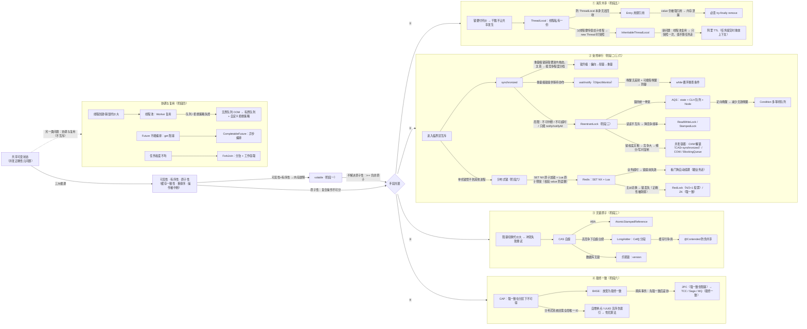

# 🌳 并发知识树 —— 全局总纲

> **定位**：`00 全景地图` 的因果骨架版。00 回答"有什么"，这棵树回答"为什么有"。
> **读法（三条规则）**：
> 1. 节点是 **问题** 或 **方案** 两种，沿路径交替出现；
> 2. 边是**因果动词**（为了 / 引发 / 代价是），不是"包含"——这棵树里不存在"a 属于 b"；
> 3. 自检：任意 **叶子 → 根** 的路径，每一步都能讲出"它为了什么被发明、它带来了什么新问题"，因果链才闭合。
>
> **用法**：每学一个新机制，在这棵树上找到它，问一句（对应 00 第一性原理节）：
> *它压缩了哪个代价、守住了哪个正确性？*

---

## 一、全局总纲图

> 📌 **md 编辑器里放不大时，用这个**：**[SVG 矢量版（浏览器打开，任意缩放）](assets/90-并发知识树-全局总纲.svg)**
> 维护：改下面的 mermaid 代码后，运行 `bash scripts/export-mermaid.sh docs/90-并发知识树-全局总纲.md` 重新导出 SVG。



---

## 二、因果链骨架（文本版，活文本，随学习迭代维护）

> 每节最后标注对应验证测试，知识树同时兼作"疑问清单 → 代码验证"的索引。

### 根：共享可变状态

共享可变状态是并发正确性问题的**唯一来源**。三大根源：

- **可见性** ← 缓存一致性（线程各自的缓存/寄存器）
- **有序性** ← 指令重排序（编译器 / CPU 乱序）
- **原子性** ← 复合操作被时间片/中断打断

**第一道防线 volatile**（阶段一）：
- 解决：可见性 + 有序性（插入内存屏障）
- 边界：**不解决原子性**（`i++` 仍非原子）→ 原子性必须交给"锁"或"CAS"
- 测试：`jmm/VisibilityTest`、`jmm/VolatilePracticeTest`、`jmm/VolatilePropagationTest`、`jmm/AtomicityTest`

### 手段光谱（docs/00 的四条路线）

| 路线 | 思路 | 代表机制 | 阶段 |
|---|---|---|---|
| ① 消灭共享 | 不让共享发生 | ThreadLocal、不可变对象 | 五 |
| ② 受控串行 | 共享了，用锁串行化 | synchronized、ReentrantLock、AQS | 二/三 |
| ③ 无锁原子 | 共享了，失败重试而非阻塞 | CAS、Atomic、乐观锁 | 三 |
| ④ 最终一致 | 正确性约束被放宽（CAP） | 分布式事务、BASE、MQ | 六 |
| ＋ 协调与复用 | 不互斥的另一类问题 | 线程池、CompletableFuture、ForkJoin | 四 |

### ① 消灭共享（阶段五）

```
锁要付代价 → 干脆不让共享发生
└─ ThreadLocal：每个线程私有
   ├─ 问题：ThreadLocal 对象本身可能无法回收
   │  └─ 方案：Entry 用弱引用
   │     └─ 新问题：value 仍被强引用 → 内存泄漏
   │        └─ 方案：try-finally remove（阿里规范铁律）
   └─ 问题：线程池复用线程，父子线程上下文不传递
      └─ 方案：InheritableThreadLocal → 线程池下失效 → 阿里 TTL
```

- 测试：`pattern/ThreadLocalLeakTest`、`pattern/ThreadLocalGCTest`、`pattern/TraceIdTest`

### ② 受控串行（阶段二/三/六）

```
问题：共享了，需要互斥 + 可见性 + 有序性
└─ synchronized（阶段二）—— 最简互斥
   ├─ 为什么字节码是 monitorenter/monitorexit？
   │  └─ 异常自动释放，不会死锁
   ├─ 为什么锁升级（偏向→轻量→重量）？
   │  └─ 重量锁获取要进内核态，代价大 → 按竞争程度分档定价
   │     ├─ 偏向锁：仅一次 CAS；撤销需 safe point，开销大
   │     ├─ 轻量锁：CAS 自旋；自旋超限白烧 CPU
   │     └─ 重量锁：ObjectMonitor 内核阻塞，wait/notify 的基础
   ├─ 为什么 wait/notify 必须在锁内？→ 条件判断与挂起的原子性
   ├─ 为什么 while 循环重查？→ 假唤醒
   └─ 局限：不可中断 / 不可超时 / 唤醒无差别 → 引出 Lock
   └─ ReentrantLock / AQS（阶段三）
      ├─ 为什么 AQS？→ 锁与同步器的统一骨架：state(volatile) + CLH 队列 + Node
      ├─ 为什么 Condition？→ 多等待队列，signal 定向唤醒，替代 notifyAll
      ├─ 为什么有公平/非公平？→ 非公平两次插队：延迟竞争、降线程切换
      └─ 为什么读写锁？→ 读读不互斥，降低竞争频率
         └─ StampedLock：乐观读零锁，写多读少更优
   └─ 并发容器（阶段三）—— 把"降竞争频率"推到数据结构内部
      ├─ CHM：全表锁竞争大 → 桶级 CAS + synchronized
      ├─ CopyOnWrite：读多写极少 → 写时复制，读无锁
      └─ BlockingQueue：生产者-消费者协作，Condition 精确唤醒
   └─ 分布式锁（阶段六）—— 单机锁管不到其他进程
      ├─ Redis：SET NX + Lua 原子释放（value 校验防误删）
      ├─ 问题：业务超时 → 锁提前失效
      │  └─ 方案：看门狗自动续期（Redisson，30s 过期 / 10s 续期）
      └─ 问题：主从切换 → 锁丢失（正确性被削弱）
         └─ 方案：RedLock（N/2+1 投票）/ ZK（强一致）
```

- 测试（锁升级/JOL）：`sync/JolLockDemoTest`、`sync/WaitUpgradeTest`、`sync/ProducerConsumerTest`、`sync/WaitVsSleepTest`、`sync/ReentrantTest`、`sync/LockObjectTest`
- 测试（AQS 经典版，jdk8-lab）：`aqs/AqsWalkthroughTest`、`aqs/MyMutexTest`、`aqs/MySemaphoreTest`、`aqs/MyBlockingQueueTest`、`aqs/FairnessTest`、`aqs/InterruptTest`、`aqs/ParkPermitTest`
- 测试（读写锁）：`juc/rwlock/RwLockCacheTest`、`juc/rwlock/LockDowngradeTest`、`juc/rwlock/StampedLockTest`
- 测试（并发容器）：`juc/container/ChmRecursiveUpdateTest`、`juc/container/BlockingQueueProducerConsumerTest`、`juc/container/LocalCacheTest`、`juc/container/WordCountTest`、`juc/container/ListenerTest`
- 测试（分布式锁）：`distributed/RedisLockTest`、`distributed/MisdeleteTest`、`distributed/WatchdogTest`

### ③ 无锁原子（阶段三）

```
锁的阻塞 + 切换代价大 → 冲突失败重试（CAS）
├─ 问题：ABA → 方案：版本号 / AtomicStampedReference
├─ 问题：高竞争下自旋白烧 → 方案：LongAdder Cell[] 分段
│  └─ 新问题：缓存行争用（伪共享）→ 方案：@Contended 填充
└─ 数据库场景：乐观锁 version，WHERE version = ?
```

- 测试：`jmm/AbaProblemTest`、`jmm/CasCounterTest`、`jmm/CasVsSyncTest`、`juc/atomic/AtomicVsAdderTest`、`juc/atomic/FalseSharingTest`、`juc/atomic/LockFreeStackTest`、`distributed/OptimisticLockTest`、`distributed/PessimisticLockTest`

### ④ 最终一致（阶段六）

```
CAP：强一致在分区下不可得（P 必选）→ 放宽为 BASE 最终一致
├─ 跨库事务：2PC 强一致但阻塞 → TCC（业务补偿）→ Saga（长事务拆链）→ MQ（消息最终一致）
└─ 分布式 ID：自增单点 / UUID 无序伤 B+ 树 → 雪花算法（1+41+10+12 位）
```

- 测试：`distributed/SagaCompensationTest`、`distributed/SnowflakeTest`、`distributed/SnowflakeDecodeTest`、`distributed/ClockBackwardTest`

### ＋ 协调与复用（阶段四，不互斥轴）

```
线程创建/销毁代价大 → 线程池：Worker 复用
└─ 问题：无界队列 OOM / 拒绝策略失控 → 方案：有界队列 + 自定义拒绝策略 + 监控 + 优雅停机

Future 局限：get 阻塞、不能编排 → CompletableFuture：异步编排（thenApply / allOf / exceptionally）

任务粒度不均 → ForkJoin：分治 + 工作窃取
```

- 测试：`pool/PoolMonitorTest`、`pool/RejectPolicyTest`、`pool/GracefulShutdownTest`、`pool/DynamicConfigTest`、`pool/ExecuteOrderTest`、`pool/CoreZeroFallbackTest`、`pool/ThreadFactoryTest`、`async/ProductDetailTest`、`async/ComposeChainTest`、`async/TimeoutFallbackTest`、`pool/ForkJoinSumTest`、`pool/ForkJoinMergeSortTest`、`pool/WorkStealingTest`

---

## 三、怎么迭代这棵树

- **主干不动**：`共享可变状态 → 三大根源 → volatile → 手段光谱` 是根，任何新机制都挂在这四条路线之一下面。
- **每个阶段一张章节级图**：本文件是脊柱，`docs/90-...` 只画到关键机制；具体链（如锁升级 4 层、Condition 四步旅程）展开到对应文档里，本文件挂链接。
- **叶子必须能落回测试**：新学一个机制，要么它出现在树上、要么它连不上——连不上说明"它压缩的代价"还没讲清。
- **矛盾即驱动**：同一机制跨路线（如 CHM 混合 CAS+锁、LongAdder 用 Cell[]）是正常的，因果链的"代价→新问题"会自然揭示它为什么混合。

## 四、相关文档

- [00 全景地图](./00-Java并发编程学习路线-全景地图.md) —— 知识清单版（优先级、阶段、必做练习）
- 各阶段文档 —— 单链因果展开版
