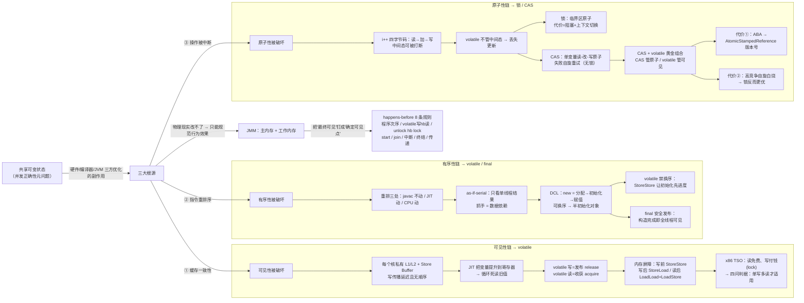

# 🌳 并发知识树 —— 阶段一：JMM · volatile · CAS

> **定位**：90 全局总纲的阶段级展开。90 画到"volatile → 手段光谱"这条脊柱，本篇把**可见性/有序性/原子性**三条链各拉到完整因果——每个机制"为什么存在、付出什么代价、缺口由谁补"。
> **服务目的**：两遍法的第二遍——第一遍通读建全景（已完成），本篇把阶段一固化进因果网络。
> **读法**：节点是问题/方案，边是因果动词；叶子→根能讲出"为什么存在"才算闭合（同 90）。
> 对应文档：[01-01](./01-01-JMM内存模型与三大特性.md) / [01-02](./01-02-volatile关键字深度解析.md) / [01-03](./01-03-CAS原理与Unsafe入门.md)

---

## 一、阶段一因果链总图

> 📌 **md 编辑器里放不大时，用这个**：**[SVG 矢量版（浏览器打开，任意缩放）](assets/91-并发知识树-阶段一-JMM-volatile-CAS.svg)**
> 维护：改下面的 mermaid 代码后，运行 `bash scripts/export-mermaid.sh docs/91-并发知识树-阶段一-JMM-volatile-CAS.md` 重新导出。



---

## 二、因果链骨架（文本版，挂验证测试）

### 根：共享可变状态 → 三大根源

并发 bug 不是 JVM 的 Bug，是**三方优化的副作用**：

| 根源 | 破坏的特性 | 机制 |
|---|---|---|
| ① 缓存一致性 | 可见性 | 私有缓存 + Store Buffer + JIT 寄存器提升 |
| ② 指令重排序 | 有序性 | 编译器 / JIT / CPU 乱序 |
| ③ 操作被中断 | 原子性 | 时间片切换打断复合操作 |

- 测试：`jmm/VisibilityTest`（可见性）、`jmm/AtomicityTest`（原子性）

### JMM：为什么必须有一份规范

```
问题：缓存、乱序是硬件物理现实，改不掉
方案：规范"行为效果"而不是"要求硬件别乱"
  → JMM：主内存 + 工作内存（逻辑抽象，≠ JVM 堆内存）
  → 核心规则：happens-before —— 把"最终可见"钉成"确定可见点"
     · 程序次序（同线程顺序）
     · volatile 写 hb volatile 读 ← 可见性链的依据
     · unlock hb 之后的 lock ← 原子性链的依据
     · start / join / 中断 / 终结 / 传递性
```

> 为什么用"规则"而不是"要求硬件别乱"：JMM 只承诺行为效果，实现交给各 JVM（这就是不同 CPU 插不同屏障的原因）。happens-before 保证"看到了什么"，不保证"逻辑上想要什么"（i++ 中间态依旧会丢）。

### 链① 可见性 → volatile

```
问题：一个线程改完，另一个看不到（可能永远看不到）
  ├─ 硬件：写留在私有缓存/Store Buffer，传播延迟且无顺序
  ├─ JIT：把频繁读的变量提升到寄存器 → 循环死读旧值
  └─ 方案：volatile
     · 写 = 发布（release）：写之前的普通写不许越过
     · 读 = 收获（acquire）：读之后的普通读写不许越过
     · 实现：内存屏障 —— 写前 StoreStore / 写后 StoreLoad / 读后 LoadLoad+LoadStore
     · 平台：x86 TSO 读免费、写要 lock 前缀（贵）→ 所以判据强调"读多写少"
  └─ 适用判据（四问全过才用）：① 单写多读？② 单次读写？③ 不需互斥？④ 读多写少？
     · 状态标志位 / DCL / CAS 的 value / 开关热更新 / 单次发布订阅
```

- 测试：`jmm/VolatilePracticeTest`（状态标志优雅停机）、`jmm/VolatilePropagationTest`（发布语义：普通写→volatile 写→volatile 读→普通读）、`myself/jmm/VolatilePracticeTest`（自己写的验证版）

### 链② 有序性 → volatile / final

```
问题：代码顺序 ≠ 执行顺序
  ├─ 重排三处：javac 几乎不动 / JIT 大动 / CPU 再动 / 缓存传播再补一刀
  ├─ 凭什么敢调？as-if-serial：单线程结果不变即可；抓手 = 数据依赖（写后读等）
  ├─ 灾难：DCL 半初始化 —— new = 分配内存→初始化→赋值引用，②③ 可换序
  │    → 另一个线程在锁外看到 instance 非 null，但对象还没构造完
  │    → synchronized 救不了（第一次检查在锁外，根本不进临界区）
  └─ 方案：
     · volatile 禁换序（StoreStore：初始化必须先于发布）
     · final 安全发布（构造方法结束即全线程可见）
  └─ 平台注意：x86 TSO 禁止 Store-Store 重排，DCL 漏 volatile 实测不崩
     → 但 JMM 不保证 + ARM/POWER 弱序会崩 —— 正确性必须建立在规范上
```

- 测试：`jmm/VisibilityTest`（半初始化通过 volatile 修复）、文档练习 3 画 DCL 重排图

### 链③ 原子性 → 锁 / CAS

```
问题：i++ 四字节码（读→加→写），中间态可被打断
  ├─ volatile 只保证单次读/写可见，管不了中间态 → 丢失更新
  └─ 两个方向：
     ├─ 锁：把读-改-写围成临界区（代价：阻塞 + 上下文切换）
     └─ CAS：单变量的读-改-写由 CPU 保证原子，失败自旋重试（无锁）
         · 本质是"代价迁移"：原子性范围从临界区收窄到单变量、
           等待从线程切换换成自旋（贵在 CPU 空转）
         · CAS + volatile 黄金组合：CAS 管原子、volatile 管可见
           （volatile 读免费、lock cmpxchg 全价，白锁白算在高竞争时放大）
         · 代价①：ABA → AtomicStampedReference 版本号（仅引用 CAS 场景）
         · 代价②：高竞争自旋白烧 → 锁反而更优（选型要 JMH 压测）
```

- 测试：`jmm/CasCounterTest`（手写 CAS 计数器）、`jmm/CasVsSyncTest`（不同竞争强度对比）、`jmm/AbaProblemTest`（版本号机制演示）、`juc/atomic/AtomicVsAdderTest`（阶段三：Atomic vs LongAdder）

### 闭环：三链在"缺口"处交汇

```
volatile 能力边界：可见性 ✅ + 有序性 ✅，原子性 ❌
  → 原子性缺口正是锁 / CAS 存在的理由
  → CAS + volatile = 无锁并发的基石（AtomicInteger 内部正是 volatile value + CAS）
  → 接 90 全局总纲：volatile 的缺口引出"手段光谱"的 ②受控串行 / ③无锁原子
```

---

## 三、与后续阶段接缝

| 本篇机制 | 缺口 | 后续补上它的机制 |
|---|---|---|
| volatile | 不保证原子性 | 阶段二 synchronized（受控串行）、阶段三 CAS/Atomic（无锁原子） |
| happens-before | 只是保证框架 | 阶段二/三的锁、volatile、start/join 都是 HB 条款的实现 |
| CAS | 高竞争自旋、ABA | 阶段三 LongAdder（Cell[] 分段）、AtomicStampedReference（版本号） |

---

## 四、相关文档

- [90 全局总纲](./90-并发知识树-全局总纲.md) —— 本篇的上一级（脊柱）
- [01-01 JMM 内存模型与三大特性](./01-01-JMM内存模型与三大特性.md) / [01-02 volatile 深度解析](./01-02-volatile关键字深度解析.md) / [01-03 CAS 原理与 Unsafe 入门](./01-03-CAS原理与Unsafe入门.md) —— 本篇的展开来源
