# 🌳 并发知识树 —— 阶段二：Synchronized 与锁机制

> **定位**：90 全局总纲"② 受控串行"路线的阶段级展开。阶段二回答一个核心问题：**synchronized 这把最基础的锁，本体如何实现（对象头 + 锁升级）、锁内如何协作（wait/notify → LockSupport）**。
> **服务目的**：两遍法第二遍——把阶段二固化进因果网络。
> **读法**：同 90/91——节点是问题/方案，边是因果动词；叶子→根能讲出"为什么存在"。
> 对应文档：[02-01](./02-01-Synchronized使用与字节码.md) / [02-02](./02-02-对象头与锁升级全链路.md) / [02-03](./02-03-wait-notify与ObjectMonitor.md) / [02-04](./02-04-LockSupport与park机制.md)

---

## 一、阶段二因果链总图

> 📌 **md 编辑器里放不大时，用这个**：**[SVG 矢量版（浏览器打开，任意缩放）](assets/92-并发知识树-阶段二-Synchronized与锁机制.svg)**
> 维护：改 mermaid 后运行 `bash scripts/export-mermaid.sh docs/92-并发知识树-阶段二-Synchronized与锁机制.md` 重新导出。

```mermaid
flowchart LR
    M["共享可变状态<br/>需要互斥"]
    M -->|"最简互斥：进入临界区"| SYN

    subgraph SYN["synchronized 使用（02-01）"]
        direction LR
        S1["锁对象是谁？<br/>实例锁 this / 静态锁 Class / 代码块锁指定对象"] --> S2["字节码 monitorenter/monitorexit<br/>异常路径也有 monitorexit → 自动释放"]
        S2 --> S3["可重入：Owner + 递归计数<br/>继承/递归场景必须可重入，否则死锁"]
    end

    SYN -->|"锁获取的代价怎么分级？"| UPGRADE
    SYN -->|"JIT 层再优化（编译器视角，与锁升级平行）"| W7["锁消除（逃逸分析）/ 锁粗化"]

    subgraph UPGRADE["锁本体：对象头 → 锁升级（02-02）"]
        direction LR
        W1["对象头 Mark Word：同一 8 字节五种解读<br/>union + tagged pointer，加锁不加对象大小"]
        W1 -->|"重量锁获取要进内核态，太贵 → 按竞争分档"| W2["无锁"]
        W2 -->|"单线程反复获取 → 一次 CAS 写线程ID"| W3["偏向锁"]
        W3 -->|"其他线程竞争 → 撤销<br/>原线程存活需 SafePoint STW（零共享写 与 可判断 物理互斥）"| W4["轻量锁：CAS 指向栈上 LockRecord"]
        W4 -->|"检测到竞争（CAS 失败）即膨胀<br/>自旋发生在膨胀后的 monitor 获取路径"| W5["重量锁：ObjectMonitor 内核阻塞 + 自适应自旋<br/>（monitor 内部三个队列 → 见 02-03）"]
        W3 -->|"撤销昂贵（SafePoint STW）+ 收益变小<br/>→ JDK15 默认禁用偏向锁"| W6["版本：JDK8 四态 / JDK17 三态"]
    end

    SYN -->|"锁内条件不满足，怎么等？"| N0

    subgraph WAIT["锁内协作：wait/notify（02-03）"]
        direction LR
        N0["持锁自旋=死锁 / 退出轮询=低效+竞态<br/>→ 交锁+挂起 = 答案"] --> N1["为什么必须锁内：<br/>①设计动机 ②API语义（释放monitor）③丢唤醒（检查+wait要原子）"]
        N1 --> N2["条件检查必须 while：<br/>假唤醒 + 竞争 + 恢复点在 wait 之后"]
        N2 --> N3["notify vs notifyAll：两类等待者共存<br/>→ notify 唤醒错的线程 → 挂死"]
        N1 -->|"等条件 vs 等锁是两回事 → 队列也得分开"| N4["_WaitSet 等条件 / _EntryList 等锁<br/>notify 只是移队，被唤醒者还要重抢锁"]
        N4 -->|"抢锁失败者要记名，但用锁保护等锁队列是自举悖论<br/>→ 入队只能无锁 CAS 头插 ⇒ LIFO 栈"| N4B["_cxq 投递口<br/>无锁 CAS 头插，LIFO"]
        N4B -->|"LIFO 会饿死先到的 → 必须重排<br/>只有持锁者有权改队列 ⇒ owner 在 exit() 搬家"| N4C["_EntryList 重排台<br/>owner 独占，双向链表"]
    end

    WAIT -->|"wait 依赖锁、信号不保存 → 另一条路线"| P0["LockSupport：任意位置可调<br/>permit 0/1 槽"]

    subgraph PARK["协作原语升级：LockSupport（02-04）"]
        direction LR
        P0 --> P1["unpark 可提前：permit 保存信号<br/>→ 不丢唤醒的第一性原理"]
        P1 --> P2["两条不丢唤醒路线：<br/>wait 靠调用原子性 vs park 靠 permit 记账"]
        P2 --> P3["中断：返回但不抛异常、标志保留<br/>→ AQS 不可中断获取的基础"]
        P3 --> P4["伪唤醒：park 也要 while 重查<br/>→ AQS 所有循环的由来"]
    end

    PARK -->|"AQS 阻塞线程的唯一工具"| AQS["阶段三：AQS 地基"]
```



---

## 二、因果链骨架（文本版，挂验证测试）

### 根：synchronized —— 最简互斥

共享可变状态需要互斥，synchronized 是最简单的一种。它是一整套机制，不是孤立的语法。

### 链① synchronized 使用（02-01）

```
问题：怎么加锁？
  ├─ 三种形态锁不同的对象：实例方法锁 this / 静态方法锁 Class / 代码块锁指定对象
  │    → 两把不同的锁互不干扰（实例+静态同时调 = 不互斥）
  ├─ 为什么自动释放锁？字节码证据：
  │    monitorenter 进入 / monitorexit 正常退出 / 异常路径也有 monitorexit → 先释放再抛
  │    → 对比 ReentrantLock 必须手动 unlock，忘了就死锁
  └─ 为什么必须可重入？
       JVM monitor 记录 Owner + 递归计数，重入计数+1，归零才释放
       → 继承（子类 synchronized 调 super 的同名方法）、递归不死锁
```

- 测试：`sync/LockObjectTest`（三种形态互斥关系）、`sync/ReentrantTest`（递归可重入）、`sync/BytecodeDemo`（javap 看 monitorenter/monitorexit）

### 链② 锁本体：对象头 → 锁升级（02-02）

```
问题：重量级锁获取要进内核态（上下文切换 1~10μs），无竞争时太浪费
  ├─ 前置：对象头 Mark Word 用同一 8 字节存五种锁状态
  │    （union 思想 + tagged pointer：指针低 2 位天然是 0，拿来当状态标签，不增加对象大小）
  ├─ 方案：按竞争程度分档定价
  │    无锁 → 偏向（单线程反复获取，仅一次 CAS 写线程ID）
  │        → 轻量（多线程交替，CAS 指向栈上 LockRecord）
  │        → 重量（竞争激烈，ObjectMonitor 内核阻塞 + 自适应自旋）
  │    ⚠️ 常见错误修正：轻量锁 CAS 失败不是"自旋超限再升级"，
  │       而是检测到竞争即膨胀；自旋发生在膨胀后的 monitor 获取路径上
  ├─ 代价：偏向锁撤销——原线程存活要 SafePoint STW（所有线程停）
  │    → 为什么绕不开：偏向锁"零共享写"（进出临界区不写 Mark Word）
  │      与"别人能判断你进没进临界区"物理互斥
  ├─ 演进：撤销贵 + 收益小 + 硬件 CAS 变便宜 → JDK15 默认禁用、JDK18 移除
  │    → JDK8 是四态升级，JDK17 是三态（无偏向锁）
  ├─ 膨胀之后：monitor 内部怎么排队？（_cxq / _EntryList / _WaitSet 三队列）
  │    → **归链③（02-03 §3）**，那里是唯一讲解处。本篇只讲锁的状态机
  └─ JIT 层再优化：锁消除（逃逸分析发现对象不逃逸）/ 锁粗化（连续加解锁合并）
```

- 测试：`sync/JolLockDemoTest`（JOL 观察无锁/偏向/轻量/重量，JDK17 需 `-XX:+UseBiasedLocking`）、`sync/WaitUpgradeTest`（wait 触发膨胀）

### 链③ 锁内协作：wait/notify（02-03）

```
问题：临界区内条件不满足，怎么等才不死锁、不低效、不丢唤醒？
  ├─ 三条路对比：持锁自旋→死锁；退出轮询→低效+竞态还在；交锁+挂起→正解
  ├─ 为什么 wait 必须在 synchronized 内（三层因果，别只背"原子性"）：
  │    ① 设计动机：synchronized 块内唯一的交锁方式是 wait()
  │    ② API 语义：wait() 的定义就是释放 monitor，必须先持有锁（单线程反证照样抛异常）
  │    ③ 正确性：把"检查 + wait + notify"放进同一把锁，notify 才落不进竞态窗口 → 不丢唤醒
  ├─ 为什么条件检查必须 while（三个原因）：
  │    ① 恢复点在 wait 之后 → if 醒来直接干活（代码位置模型）
  │    ② 竞争：抢到锁前条件可能已被别的线程改掉
  │    ③ 假唤醒：OS 原语被设计成"宁多醒勿漏醒"，规范明确允许 wait 无故返回
  ├─ 为什么多生产者多消费者用 notifyAll：
  │    两类等待者（等不满的生产者 + 等不空的消费者）共存同一 WaitSet
  │    → notify 可能唤醒错线程 → 它重查后睡回去 → 真正能改状态的人还睡着 → 挂死
  └─ 机制：ObjectMonitor 三个队列——_WaitSet（等条件）/ _EntryList（等锁）/ _cxq（投递口）
       ① 等条件 vs 等锁是两回事 → 队列也得分开
       ② 抢锁失败者要"记名"，但用锁保护"等锁队列"是自举悖论（谁保护那把锁？）
          → 入队必须无锁 → 无锁单链表上头插最便宜 → _cxq 是 LIFO 栈
       ③ LIFO 会饿死先到的 → 得有人重排；只有持锁者有权改队列
          → owner 在 exit() 把 _cxq 搬进 _EntryList（双向链表）顺手重排
       ④ _WaitSet 却能上真锁（_WaitSetLock）：写它的人刚 wait 完、要睡很久
          → 成本预算不同 ⇒ 允许的同步手段不同
       ⚠️ 常见错误修正：被唤醒 ≠ 成为 _owner。唤醒只给"重新竞争的资格"，
          还要 CAS 赢一次 → 这就是 synchronized 非公平（barging）的来源；
          _succ（内定继任者）用于抑制"醒了一群、只跑一个"的无效唤醒
```

- 测试：`sync/ProducerConsumerTest`（2 生产者 + 3 消费者，刻意改 if/notify 观察 bug）、`sync/WaitVsSleepTest`（wait 释放锁 / sleep 不释放）、`sync/MonitorQueueStateTest`（三队列 ↔ 三线程状态：BLOCKED/WAITING，验证 notify 只移队不给锁 + barging 观察）

### 链④ 协作原语升级：LockSupport（02-04）

```
问题：wait/notify 绑定锁、信号不能提前保存（wait 前 notify 会丢）——能否换一种？
  ├─ LockSupport：任意位置可调，permit 0/1 槽
  │    park 消费 permit（1→0 立即返回，0→阻塞）
  │    unpark 置 1（可提前！无等待者时信号保存在 permit 里）
  ├─ 不丢唤醒的两条路线（本阶段最重要的贯穿对比）：
  │    wait/notify：靠调用原子性（检查+wait 融合，notify 插不进窗口）
  │    park/unpark：靠 permit 记账（unpark 提前，等待者到来时直接消费）
  ├─ 中断语义：park 返回但不抛异常、标志保留
  │    → 对比 wait 抛 InterruptedException 且清标志
  │    → 这是 AQS 实现"不可中断获取"的基础（决定权交给调用方）
  └─ 伪唤醒：park 也要 while 重查 → AQS 所有循环（acquireQueued/await）的由来
```

- 测试：`jdk8-lab` 的 `aqs/ParkPermitTest`（8 场景逐条验证 permit 推演①②、推论 1/3、中断四态）

### 闭环：两条协作路线 → AQS 地基

```
wait/notify（绑定锁，ObjectMonitor 队列）
park/unpark（不依赖锁，permit 记账，可提前唤醒）
        │
        ▼  AQS 阻塞线程的唯一工具是 park/unpark
   阶段三：acquireQueued 里 park、Condition 里 await、unparkSuccessor 里 unpark
   —— 所有"唤醒设计"的根都在 02-04 的 permit 机制
```

---

## 三、与后续阶段接缝

| 本篇机制 | 缺口 | 后续补上它的机制 |
|---|---|---|
| synchronized | 不可中断 / 不可超时 / 唤醒无差别 | 阶段三 ReentrantLock + Condition（定向唤醒） |
| wait/notify | 只有一个等待队列，notify 无差别 | 阶段三 Condition 多等待队列 |
| park/unpark | 只是原语，需要排队 + 公平性 | 阶段三 AQS：state + CLH 队列构建在 permit 之上 |

---

## 四、相关文档

- [90 全局总纲](./90-并发知识树-全局总纲.md) —— 本篇的上一级（"② 受控串行"路线）
- [91 阶段一](./91-并发知识树-阶段一-JMM-volatile-CAS.md) —— 上一篇（happens-before 的锁规则在这里落地）
- [02-01](./02-01-Synchronized使用与字节码.md) / [02-02](./02-02-对象头与锁升级全链路.md) / [02-03](./02-03-wait-notify与ObjectMonitor.md) / [02-04](./02-04-LockSupport与park机制.md) —— 本篇的展开来源
