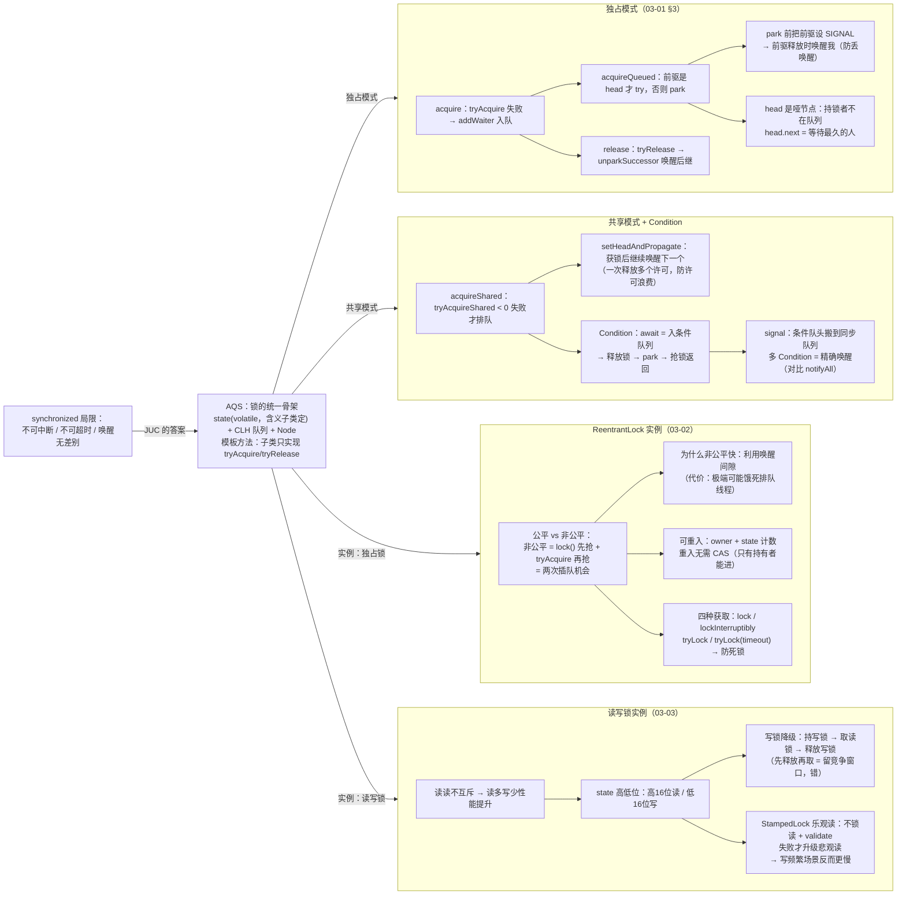

# 🌳 并发知识树 —— 阶段三：AQS 与锁

> **定位**：90 全局总纲"② 受控串行"路线的阶段级核心展开。阶段三体量大（8 篇），分 3 张图：**93=AQS 与锁**（03-01/02/03）、94=并发容器、95=原子类与同步工具。
> **本篇核心**：**AQS 是 JUC 所有锁和同步器的骨架**——拿下它，ReentrantLock / 读写锁 / Semaphore / CountDownLatch 全是它挂出来的实例。
> **版本口径**：AQS 按经典版（JDK 8~20，SIGNAL/acquireQueued）讲解，与 03-01/03-02 文档、`jdk8-lab` 一致；JDK 21 重构版差异见 03-02 §7.11。
> 对应文档：[03-01](./03-01-AQS框架源码解析.md) / [03-02](./03-02-ReentrantLock源码全解析.md) / [03-03](./03-03-ReentrantReadWriteLock与StampedLock.md)

---

## 一、AQS 与锁因果链总图

> 📌 **SVG 放大版（浏览器打开，任意缩放）**：[assets/93-并发知识树-阶段三-AQS与锁.svg](assets/93-并发知识树-阶段三-AQS与锁.svg)
> 维护：改 mermaid 后运行 `bash scripts/export-mermaid.sh docs/93-并发知识树-阶段三-AQS与锁.md` 重新导出。



---

## 二、因果链骨架（文本版，挂验证测试）

### 根：synchronized 局限 → AQS

```
synchronized 管不到的三件事：不可中断、不可超时、只能 notify/notifyAll（无差别唤醒）
→ JUC 需要一套可扩展的锁骨架：AQS
  · state（volatile）：同步状态，含义由子类定义（重入次数/许可数/计数）
  · CLH 队列：获取锁失败的线程的"等待室"
  · Node：waitStatus 五种状态（CANCELLED/SIGNAL/CONDITION/PROPAGATE/0）
  · 模板方法：子类只写 tryAcquire/tryRelease，排队/阻塞/唤醒全由 AQS 管
```

### 链① 独占模式 acquire 全流程（03-01 §3）

```
问题：一个线程拿不到锁，怎么等？
  ├─ tryAcquire 失败 → addWaiter 入队（CAS 入队，快速路径 + enq 完整路径）
  ├─ acquireQueued 循环：只有"前驱是 head"才 tryAcquire
  │    → 为什么？head 是哑节点（持锁者不在队列），head.next 永远是等待最久的人 → FIFO
  ├─ 失败 → shouldParkAfterFailedAcquire：把前驱设 SIGNAL 再睡
  │    → 为什么必须设 SIGNAL 才 park？否则前驱释放时不知道有人等着 → 丢唤醒
  │    → 为什么设完还要转一圈？既确认 SIGNAL 生效，又顺手再试一次获取（省一次 park）
  └─ release：tryRelease 成功 → unparkSuccessor 唤醒后继
      → 后继已取消则从 tail 往前找最近的活节点
```

- 测试（经典版，jdk8-lab）：`aqs/AqsWalkthroughTest`（走读全流程）、`aqs/MyMutexTest`（手写 AQS 互斥锁）

### 链② 共享模式 + Condition

```
共享模式（Semaphore/CountDownLatch）：
  独占：只有 1 个持有者；共享：多个线程可同时持有
  ├─ acquireShared：tryAcquireShared < 0 才排队（返回值 int：既表成败又传剩余资源）
  ├─ setHeadAndPropagate：获锁后还要继续唤醒下一个共享节点
  │    → 为什么必须传播？一次释放可能放行多个，若只唤醒一个，多余许可就"白送"了
  │    → 传播本质是"防丢唤醒"，不只是"多叫几个人"
Condition（和 wait/notify 同构，增量是多队列）：
  ├─ await 四步：入条件队列 → 完全释放锁（savedState 记重入层数）→ park → 抢锁返回
  ├─ signal：条件队列头 → 搬到同步队列（notify 是移队，signal 也是）
  └─ 对比 wait/notify：多 Condition = 精确唤醒（生产者只唤 notEmpty，不惊群）
```

- 测试（jdk8-lab）：`aqs/MySemaphoreTest`（手写共享模式）、`aqs/MyBlockingQueueTest`（双 Condition 有界队列）

### 链③ ReentrantLock 实例（03-02）

```
公平 vs 非公平（同一 AQS，差异只在 tryAcquire）：
  ├─ 非公平：lock() 直接 CAS 抢一次 + tryAcquire 再抢一次 = 两次插队
  │    → 为什么快？唤醒线程有延迟（唤醒间隙），新线程插队利用间隙 → 省一次唤醒+切换
  │    → 代价：极端可能饿死排队线程（概率低）
  ├─ 公平：tryAcquire 先 hasQueuedPredecessors() 检查队列，有人排队就等
  │    → 为什么 head.next==null 窗口必须保守返回 true？防新线程插队破坏公平
可重入：exclusiveOwnerThread + state 计数；重入 setState 不需要 CAS（只有持有者能进）
四种获取方式：
  lock（无限等，不响应中断）→ lockInterruptibly（响应中断）
  → tryLock（立即返回）→ tryLock(timeout)（限时）→ ★ 防死锁首选
```

- 测试（jdk8-lab）：`aqs/FairnessTest`（公平/非公平获取顺序）、`aqs/InterruptTest`（lock vs lockInterruptibly）、`aqs/TryLockDeadlockTest`（tryLock 防死锁，死锁版 @Disabled）

### 链④ 读写锁 + StampedLock（03-03）

```
问题：缓存场景读 90% 写 10%，synchronized 读读也互斥 → 吞吐极低
  ├─ 读写锁：读读不互斥、读写/写写互斥
  │    ├─ state 高低位拆分：高16位读计数 / 低16位写计数（一个 int 两把锁）
  │    ├─ 读锁重入：多线程各自持有 → ThreadLocal + HoldCounter（state 只够记写锁重入）
  │    ├─ 写锁降级：持写锁 → 取读锁 → 释放写锁（保持读的连续性）
  │    │    → 为什么不能反过来先释放再取？中间留竞争窗口，其他写者插队 → 脏读
  │    └─ 读锁不能升级写锁：多个读者都想升级 → 互相等 → 死锁
  └─ StampedLock 乐观读：tryOptimisticRead 不锁直接读 + validate 校验
       → 校验失败才升级悲观读 → 读多写少最快；写频繁 validate 常失败 → 反而更慢
选型决策树：
  需要 Condition → ReentrantLock；读读并行 → RWLock；
  写很少 + 极致性能 → StampedLock；其余 → synchronized
```

- 测试（主工程）：`juc/rwlock/RwLockCacheTest`（读写锁缓存）、`juc/rwlock/LockDowngradeTest`（降级/不支持升级）、`juc/rwlock/StampedLockTest`（乐观读）

### 闭环：AQS 是半壁江山

```
AQS 独占模式 → ReentrantLock、Worker（线程池）
AQS 共享模式 → Semaphore、CountDownLatch
AQS 独占+共享 → ReentrantReadWriteLock
→ 04 阶段线程池的 Worker 也是 AQS 独占；03 阶段的容器/原子类继续复用 CAS + volatile
```

---

## 三、与后续阶段接缝

| 本篇机制 | 后续承接 |
|---|---|
| AQS 队列 + park | 04 线程池 Worker（AQS 独占）；`jdk8-lab` 是所有 AQS 走读的现场 |
| Condition 多队列 | 04 生产者-消费者模式、BlockingQueue（03-05） |
| CAS + state | 03-06 原子类 LongAdder 的分段；03-04 CHM 的桶锁 |

---

## 四、相关文档

- [90 全局总纲](./90-并发知识树-全局总纲.md) / [92 阶段二](./92-并发知识树-阶段二-Synchronized与锁机制.md) —— 本篇的上一级
- [03-01](./03-01-AQS框架源码解析.md) / [03-02](./03-02-ReentrantLock源码全解析.md) / [03-03](./03-03-ReentrantReadWriteLock与StampedLock.md) —— 本篇的展开来源
- 阶段三其余两图：94 并发容器、95 原子类与同步工具（待拆）
