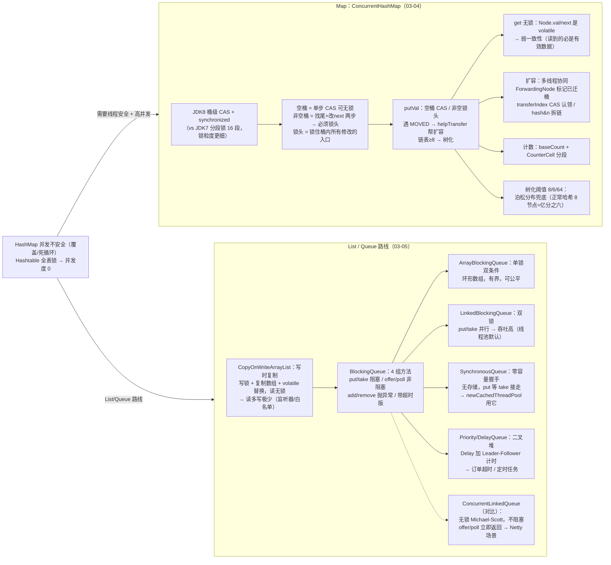

# 🌳 并发知识树 —— 阶段三：并发容器

> **定位**：90 全局总纲"② 受控串行"路线的"降竞争频率"分支展开（阶段三第 2 张图）。核心问题：**把锁从"整个结构"细分到"能多小就多小"**——CHM 细到桶、COW 干脆写时复制、BlockingQueue 用精确唤醒。
> **服务目的**：两遍法第二遍——把 03-04/03-05 固化进因果网络。
> 对应文档：[03-04](./03-04-并发容器之ConcurrentHashMap.md) / [03-05](./03-05-并发容器之其他容器.md)

---

## 一、并发容器因果链总图

> 📌 **SVG 放大版（浏览器打开，任意缩放）**：[assets/94-并发知识树-阶段三-并发容器.svg](assets/94-并发知识树-阶段三-并发容器.svg)
> 维护：改 mermaid 后运行 `bash scripts/export-mermaid.sh docs/94-并发知识树-阶段三-并发容器.md` 重新导出。



---

## 二、因果链骨架（文本版，挂验证测试）

### 根：HashMap 不安全 / Hashtable 低并发 → 并发容器

```
HashMap：并发 put → 数据覆盖、JDK7 扩容环形链表死循环 → 线程不安全
Hashtable：所有方法 synchronized → 全表一把锁 → 并发度 0
→ 需要：线程安全 + 高并发。两条路线：
  Map  → CHM（把锁细分到桶）
  List/Queue → COW / BlockingQueue（写时复制 / 精确唤醒）
```

### 链① ConcurrentHashMap（03-04）

```
问题：怎么让 Map 线程安全又不牺牲并发？
  ├─ JDK7 分段锁（Segment[]，16 段，每段一把 ReentrantLock）→ 粒度仍粗
  ├─ JDK8 桶级：空桶单步 CAS 无锁；非空桶锁"头节点"
  │    → 为什么锁头就够？对桶的一切修改从头部进入：要么 CAS 换头，要么从头遍历
  │    → 为什么非空桶必须锁？插入 = 找尾节点 + 改 pred.next 两步，读写位置分离
  ├─ 为什么双重检查？锁的 f 可能已被替换（并发 CAS 新头/树化）→ 锁内再验 tabAt == f
  ├─ 三层并发模型：
  │    ① hash 划分（不同桶无共享）→ 期望并发度 = 桶数
  │    ② 桶内锁头（守结构不变量）
  │    ③ 全局协同用 CAS（sizeCtl / transferIndex / baseCount），不上全局锁
  │    → 并发问题没被"避免"，是被"局限化"（影响半径缩小到单桶）
  ├─ get 无锁：Node.val/next 是 volatile → 可见性；弱一致性（读到必有效，可能稍旧）
  ├─ 扩容 transfer：stride 分桶 → transferIndex CAS 认领 → ForwardingNode 标记
  │    → hash&n 拆链（不用重哈希）；put 遇 MOVED 帮忙 → 扩容不停摆
  ├─ 计数 addCount + CounterCell：baseCount CAS 竞争激烈 → 分段累加（LongAdder 思路）
  └─ 树化 8/6/64：8 靠泊松分布（正常哈希下几乎不可能，出现=哈希崩/攻击）；6≠8 防抖振；64 以下先扩容
关键坑：复合操作不原子（containsKey+put → 用 merge/computeIfAbsent）；key/value 禁 null（并发歧义）；computeIfAbsent 内禁止回写（递归）
```

- 测试（主工程 `juc/container/`）：`WordCountTest`（merge 原子计数 vs containsKey+put 丢更新）、`LocalCacheTest`（computeIfAbsent 懒加载只执行一次）、`ConcurrencyTest`（弱一致性观察）、`ChmRecursiveUpdateTest`（computeIfAbsent 回写陷阱）
- 测试（jdk8-lab `juc/container/`）：`ChmVerifyTest`（JDK8 版 null/递归验证）

### 链② CopyOnWriteArrayList（03-05）

```
问题：读多写极少的场景（监听器/白名单），读写锁也太重
  ├─ 方案：写时复制——写 = 加锁 + 复制新数组 + volatile 替换引用；读 = 直接读快照
  ├─ 收益：读无锁（性能极高）、迭代器快照安全（不抛 CME）
  └─ 代价：每次写 O(n) 复制 → 写频繁/数据大是灾难；弱一致性（读可能旧）
```

- 测试：`juc/container/ListenerTest`（事件总线：发布并发注册/移除）

### 链③ BlockingQueue 家族（03-05）

```
BlockingQueue = 队列 + 阻塞语义（put 满等 / take 空等），内部用 Condition
  ├─ 4 组方法：put/take（阻塞，生产消费主线程）/ offer/poll（非阻塞试探）
  │            / add/remove（抛异常，不推荐）/ 带超时版（限时，防永久阻塞）
  ├─ ArrayBlockingQueue：单锁双条件 + 环形数组（有界）——简单、内存一致强
  ├─ LinkedBlockingQueue：双锁（takeLock/putLock）——put/take 真并行，吞吐高
  │    → 线程池默认队列；代价：count 用 AtomicInteger、内存一致弱
  ├─ SynchronousQueue：零容量"握手通道"，put 必须等 take 接走
  │    → newCachedThreadPool 用它：任务不堆积 → 线程按需创建
  ├─ PriorityBlockingQueue / DelayQueue：二叉堆排序；Delay 加 Leader-Follower 计时
  │    → 订单超时取消 / 定时任务
  └─ ConcurrentLinkedQueue：无锁（Michael-Scott）但不阻塞 → Netty 场景
选型：需要阻塞 → BlockingQueue；无锁不阻塞 → CLQ；size() 不精确用 isEmpty()
```

- 测试：`juc/container/BlockingQueueProducerConsumerTest`（代码量是 wait/notify 的 1/5）、`OrderTimeoutTest`（DelayQueue 订单超时取消）、`ListenerTest`

### 闭环：把"降竞争"贯彻到底

```
CHM 桶锁 / COW 写时复制 / BlockingQueue 精确唤醒
→ 三者都是 90 总纲"降低竞争频率"方向的具体化：
  锁粒度细到"操作的最小区间"，该无锁的地方（空桶 CAS / 读快照）绝不加锁
```

---

## 三、与后续阶段接缝

| 本篇机制 | 后续承接 |
|---|---|
| CounterCell 分段计数 | 03-06 LongAdder 的 Cell[]（CHM 借鉴 LongAdder，同一思路） |
| BlockingQueue | 04 线程池的任务队列、拒绝策略 |
| 无界队列 OOM 风险 | 04 线程池生产规范（禁止 Executors 无界队列） |

---

## 四、相关文档

- [90 全局总纲](./90-并发知识树-全局总纲.md) / [93 AQS 与锁](./93-并发知识树-阶段三-AQS与锁.md) —— 本篇的上一级
- [03-04](./03-04-并发容器之ConcurrentHashMap.md) / [03-05](./03-05-并发容器之其他容器.md) —— 本篇的展开来源
- 阶段三第三张：95 原子类与同步工具（待拆）
