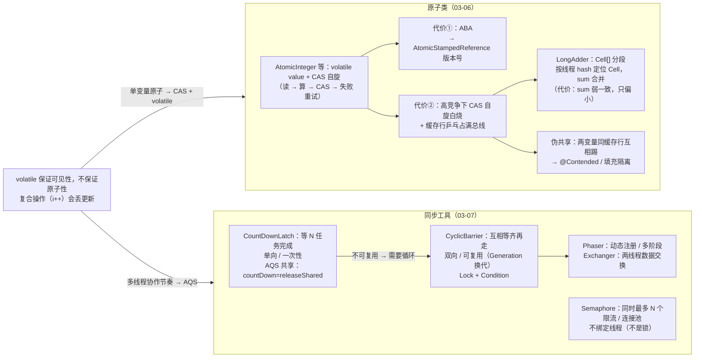

# 🌳 并发知识树 —— 阶段三：原子类与同步工具

> **定位**：90 全局总纲"③ 无锁原子"路线 + "② 受控串行"协作工具的阶段级展开（阶段三第 3 张图，收官）。两条线：**原子类**把"单变量的读-改-写"焊死（CAS + volatile），**同步工具**把"多线程协作的节奏"管起来（AQS 共享模式）。
> **服务目的**：两遍法第二遍——把 03-06/03-07 固化进因果网络。
> 对应文档：[03-06](./03-06-原子类与LongAdder.md) / [03-07](./03-07-同步工具类.md)

---

## 一、原子类与同步工具因果链总图

> 📌 **SVG 放大版（浏览器打开，任意缩放）**：[assets/95-并发知识树-阶段三-原子类与同步工具.svg](assets/95-并发知识树-阶段三-原子类与同步工具.svg)
> 维护：改 mermaid 后运行 `bash scripts/export-mermaid.sh docs/95-并发知识树-阶段三-原子类与同步工具.md` 重新导出。



---

## 二、因果链骨架（文本版，挂验证测试）

### 根：volatile 的原子性缺口 → 两条补法

```
volatile 只管可见性/有序性，i++（读-改-写）中间态照样丢更新
→ 两条补法：
  ① 单变量原子 → CAS + volatile（原子类）——把"读-算-写"缝隙焊死
  ② 多线程协作 → AQS（同步工具）——管"谁等谁、最多几个进"
```

### 链① 原子类（03-06）

```
问题：i++ 不原子，怎么无锁地原子更新？
  ├─ AtomicInteger 等：volatile value + CAS 自旋（读→算→CAS→失败重试）
  │    → 本质：乐观重试，不阻塞（对比锁的悲观阻塞）
  ├─ AtomicReference：指针 CAS —— 纪律是"换而不改"
  │    （CAS 比较的是引用位模式，管不了对象内部 → 要么不可变、要么每次换新引用）
  │    → 无锁栈用它，但有 ABA 风险
  ├─ 代价①：ABA → AtomicStampedReference（值 + 版本号一起 CAS）
  ├─ 代价②：高竞争下 CAS 自旋白烧（9/10 线程空转）+ 缓存行乒乓占满一致性总线
  │    → 这催生 LongAdder：把 1 个变量拆成 N 个 Cell，按线程 hash 确定性定位
  │       sum() 合并所有 Cell；扩容上限 NCPU（超过必有共享，摊薄无收益）
  │       → 代价：sum 弱一致（遍历时有线程在 add，只偏小不偏大）
  └─ 伪共享：两个"不同变量"同缓存行（64B），一个被写 → 整个缓存行失效互相踢
       → 解决：@Contended 独占缓存行 / 手动填充
       → 主战场在基础设施层（LongAdder Cell / CHM CounterCell / Disruptor 序号）
选型：
  AtomicLong：低竞争、需要精确值（sum 强一致）
  LongAdder：高竞争、统计类（QPS/流量，允许近似）
  → 同一时间大量线程自增 → LongAdder；需要精确读取 → AtomicLong
```

- 测试（主工程 `juc/atomic/`）：`AtomicVsAdderTest`（不同竞争强度压测对比）、`FalseSharingTest`（伪共享填充隔离对比）、`LockFreeStackTest`（AtomicStampedReference 无锁栈）
- 测试（`jmm/`）：`AbaProblemTest`（版本号机制）、`CasCounterTest`（手写 CAS）

### 链② 同步工具（03-07）

```
问题：多线程协作需要"节奏控制"——等齐、限量、单向等
  三个工具解决三种节奏（03-07 总览表）：
  ├─ CountDownLatch：等 N 个任务完成再汇总（单向：主线程等子线程）
  │    AQS 共享模式：countDown = releaseShared（state-1），
  │    await = acquireShared（state≠0 阻塞），归零 → setHeadAndPropagate 唤醒所有
  │    → 一次性（计数只能减不能加）；countDown 必须放 finally
  ├─ CyclicBarrier：N 个线程互相等齐再走（双向），自动重置可复用
  │    ReentrantLock + Condition；Generation 每轮换代
  │    → 某线程超时/中断 → 代被打破 → 所有等待者抛 BrokenBarrierException
  │    → 为什么 Latch 不能复用而它能？Latch 计数单调减；Barrier 靠代重置
  ├─ Semaphore：同时最多 N 个线程进入（限量，不是等待）
  │    AQS 共享；acquire/release 不绑定线程（⚠️ 不是锁，没有持有者概念）
  │    → 限流 / 连接池；tryAcquire 快速失败
  └─ Phaser / Exchanger：动态注册多阶段（Barrier 增强）/ 两线程交换数据（了解）
三者一句话：
  CountDownLatch = 一个裁判等所有运动员跑完
  CyclicBarrier  = 所有运动员互相等齐才开跑（还能再来一轮）
  Semaphore      = 停车场限 N 辆车
```

- 测试（主工程 `juc/tools/`）：`CountDownLatchTest`（多任务汇总 + 忘 countDown 演示）、`CyclicBarrierTest`（两阶段并行 + 复用）、`SemaphoreTest`（限流，最大并发 ≤ 3）

### 闭环：阶段三收官

```
原子类 = 单变量原子（CAS+volatile，无锁）
同步工具 = 多线程协作（AQS 共享模式）
容器 = 把锁细分到桶（CHM）/ 写时复制（COW）
锁 = AQS 独占模式（ReentrantLock）/ 共享（RWLock）
→ 阶段三整个体系：AQS 骨架 + CAS + volatile 三件套撑起 JUC 半壁江山
```

---

## 三、与后续阶段接缝

| 本篇机制 | 后续承接 |
|---|---|
| AQS 共享模式（Latch/Semaphore） | 04 线程池 `Worker`（AQS 独占）、`ctl` 位运算 |
| LongAdder 分段计数 | 04 线程池监控计数、CHM 的 CounterCell |
| Semaphore 限流 | 05 限流模式（令牌桶等） |

---

## 四、相关文档

- [90 全局总纲](./90-并发知识树-全局总纲.md) / [93 AQS 与锁](./93-并发知识树-阶段三-AQS与锁.md) / [94 并发容器](./94-并发知识树-阶段三-并发容器.md) —— 阶段三系列
- [03-06](./03-06-原子类与LongAdder.md) / [03-07](./03-07-同步工具类.md) —— 本篇的展开来源
- **阶段三拆图完成**（93/94/95）；下一个阶段：04 线程池与异步编程
