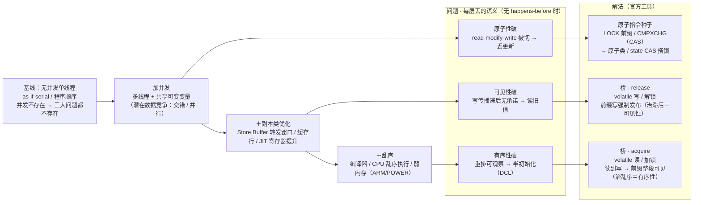

# T-Derivation-01 · 官方对名版

> **姊妹文档**：把 `docs/T-Derivation-01.md` 的自造名词**逐条换成官方说法**（Java/JMM + 硬件）。因果链结构、论证顺序、结论一字不动——只换名字，不改推导。
> 源文档开头写"名词一律自造，不与课本对名（对名留到学工具时再做）"；工具已学到 02/03/01 各章，此文档就是那份补做的对名。
> **读法**：先扫 [§1 对名总表](#1-对名总表自造词--官方词)，再看 [§2 失真与粒度差异](#2-失真与粒度差异对名不是处处-11)，最后 [§4 官方版全链图](#4-官方版全链图安全基线--逐层破--解法)。

---

## 0 · 对照基准

- 源文档论证的是**通用并发**（任何语言）；官方版以 **Java/JMM（JSR-133、JLS §17.4）+ 硬件层** 为名。
- "官方名"以本仓库已重构文档的措辞为锚点：`01-01`（as-if-serial / 数据竞争 / happens-before）、`01-02`（volatile 写=release、读=acquire、JSR-133 屏障表）、`02-03`（监视器、monitor 规则）、`03-01`（AQS state + CLH）、`03-06`（原子类 = volatile + CAS）。
- 自造词里已经有"天然官方"的（三大问题本身），表内标 `＝官方词`，不再改。

## 1 · 对名总表（自造词 → 官方词）

### 1.1 基线（源 §1）

| 自造词（源 §） | 官方名 | 为什么等价 | 锚点 |
|---|---|---|---|
| 安全基线＝只有一个执行流 | **as-if-serial / 程序顺序**（单线程内编译器、CPU 可重排，但可观察结果等价于按序执行） | 单线程里没有第二个观察者，私有化、重排都不可观察——"并发不存在所以不会错"的官方形态 | JLS §17.4 单线程语义；01-01 §1.2.8 |
| 并发不存在 → 三大问题不存在 | **正确同步（无数据竞争）→ 执行表现为顺序一致（SC）** 的特例 | JMM 的主线承诺：承诺给到"无竞争程序整体像 SC 一样跑"，竞争处才撒手。SC 正是源文档当作"想保住的最强模型"的那个东西 | JLS §17.4.3；01-01 |

### 1.2 逐层离开基线（源 §2）

| 自造词（源 §） | 官方名 | 为什么等价 | 锚点 |
|---|---|---|---|
| 加并发（指令粒度交错 / 并行） | **多线程 + 共享可变变量 = 潜在数据竞争**（两个线程访问同一变量、至少一写、无 happens-before 排序） | 只有"共享 + 交错"才有竞争；复合操作被切丢更新对应官方"read-modify-write 需要原子化/串行化" | 01-01 §1.2 |
| ＋副本类优化（私有缓存 / Store Buffer / JIT 不再读） | **写传播滞后**：缓存一致性按行收敛（L1/L2 MESI、L3 共享），Store Buffer 转发产生"本核已执行、别核暂不可见"的有界窗口；JIT 把循环不变读提升进寄存器 | "副本=滞后、相对序仍按源码"即：一致性只保证单地址最终收敛，不保证时间上"立即"，且不颠顺序 | X-Deep-01 §3~§4 |
| ＋乱序（编译 / CPU / 弱内存） | **编译器重排 / CPU 乱序执行 / 弱内存模型**（ARM/POWER 四种重排都可能；x86 TSO 只允许 Store-Load） | 乱序可观察才构成有序性问题；JMM 不靠禁止重排，而靠 happens-before 定义"哪些排序被承诺" | 01-02 §3.4（x86 vs ARM） |

### 1.3 三大问题（源 §3）

| 自造词 | 官方名 | 说明 |
|---|---|---|
| 可见性 / 原子性 / 有序性、丢更新、读旧值、半初始化 | **＝官方词**（Java 教材三大特性同名） | 只有"门开了、前面的货没到"这类比喻要还原本义：半初始化 = DCL 场景、丢更新 = `count++`、读旧值 = 无限循环退不出 |

### 1.4 解法总原则（源 §4）

| 自造词（源 §） | 官方名 | 为什么等价 |
|---|---|---|
| 打点，不全局 | **同步只加在"会变成数据竞争的共享访问"处** | 全同步是对 SC 的过度保证；打点 = 精确到竞争点 |
| 声明即承诺：没点名的访问无承诺 | **happens-before 只由程序顺序 + 同步动作（规则里的 8 条）产生；普通未同步共享访问无任何跨线程承诺** | 8 条规则就是"点名的交接访问"清单：程序顺序、volatile、monitor lock/unlock、线程 start/join、传递性… |
| 不可分割的最小种子在硬件 | **CPU 原子指令**：x86 `LOCK` 前缀 / `CMPXCHG`、ARM `LDXR/STXR`，经 `Unsafe.compareAndSwapInt` 暴露给 Java | "我们写的任何代码都是多条指令"→ 种子只能由硬件给 |
| 解法的分工照抄破的分层 | 原子性 → **原子类 / 互斥**；可见性、有序性 → **happens-before（volatile / 锁进出 / final / start/join）** | 各层各自补，不互相替代 |

### 1.5 桥（源 §5）——对名核心

| 自造词（源 §） | 官方名 | 为什么等价 | 锚点 |
|---|---|---|---|
| 标记变量 | **volatile 变量**（访问不可被私有化：读不缓存、写即发布） | "挑出承担交接的访问并标记" = volatile 的声明语义 | 01-02 §2 |
| 发布点（写方写标记变量） | **volatile 写（release 语义）**；等价形态还有**监视器解锁 / `Lock.unlock`** | 发布方把前缀带出；JLS 表达为"对某 volatile 的写 hb 于后续读到它的读" | JLS volatile 规则；01-02 §2.1 |
| 观察点（读方读同一变量取到新值） | **volatile 读（acquire 语义）**；等价形态还有**监视器加锁 / `Lock.lock`** | 读到某次写值 → 与那次写建立 happens-before | JLS volatile / monitor 规则；01-02 §2.2 |
| 前墙（前缀写不许拖到点后） | volatile 写前的 **StoreStore 屏障** + 编译层"点前普通写不重排到写后" | 发布时必须带出整段前缀，不丢前面的货 | 01-02 §3.3 屏障表 |
| 后墙（点后动作不许偷渡越点） | volatile 写后的 **StoreLoad 屏障**（保守策略；release 语义本身不禁止普通读越写，多买这面墙正是"双墙比单墙贵"的原因） | 防"不该来的未来货跑进来" | 01-02 §3.3（"普通读越过 volatile 写是 release 允许的"） |
| 观察点护栏（受保护读不许偷跑） | volatile 读后的 **LoadLoad + LoadStore 屏障** | 读到新值 ≠ 后续读已发生，护栏钉住 | 01-02 §3.3 |
| 整段前缀 / 完整快照 | **happens-before 传递性**：前缀（程序顺序）→ 发布（同步规则）→ 读者读到（同步规则）→ 读者后续（程序顺序） | 一座桥 = 一条 hb 边；桥可跨线程接龙 = hb 传递 | JLS §17.4.5 |
| ① guard 亮 ≠ 领到货 | volatile 读**不阻塞**，只保证"与读到的那次写之间有 hb 的内容可见"；货到与否由写方逻辑决定 | while 轮询只决定何时过点 | 01-02 §2.3 |
| ② 可见性单调、多看无害 | **安全发布不可变对象**：对象内 `final`（构造时冻结）+ 对外 volatile 引用 | 已定型不再写 → 只有 release 墙要防"带不齐"，无需防逆向破坏 | 05-02；01-02 2.5 final 对照 |
| ③ 优化自由度分区、按点计费 | 屏障只花在**同步点邻域**；离点远的代码 JIT 照常优化；volatile 按每次访问（=点）付，不因"变量多"额外 | "固定税按点收" = volatile 的每次访问屏障开销 | 01-02 §3.5 |
| A 单向门 vs B 快照分界 | **acquire/release 单墙档 vs volatile / synchronized 全墙**：前者 = `VarHandle`/`Unsafe` 的 `getAcquire`/`setRelease`、C++ acq/rel（x86 上 acquire 读几乎免费）；后者 = Java 关键字 volatile（保守插全墙）与 monitor 进出（进出都墙） | 官方语言里没有"按点挑墙"的默认：Java 关键字走保守双墙，换推理简单——与源选 B 同动机 | 01-02 §3.4（x86 读免费/写付钱） |

### 1.6 桥的串联规则（源 §6）

| 自造词（源 §） | 官方名 | 为什么等价 |
|---|---|---|
| 同一线程多次发布 → 前缀累积 | **程序顺序规则 + 传递性**：w₁ → w₂（程序顺序），读 r 见 w₂ ⇒ w₂ hb r 且 w₁ hb w₂ ⇒ w₁ 也可见 | 迟到读者见完整历史 = hb 传递 |
| 跨线程接龙 | **happens-before 的传递性**（经典 monitor 链：A 解锁前写 x → B 加锁读 x、写 y、解锁 → C 加锁读 y 可见 x） | "Y 的写排进 X 的前缀随 X 再发布" = hb 沿边传递 |
| 多写方 (a) 各写各的 | 各写方各自 release 到各自 volatile，读者对每个分别 acquire | 无公共发布点时无法合成一张快照 |
| 多写方 (b) 汇合点协调者 | **用锁/栅栏把多写收成一个发布点**：合并区进同一把锁，或 `CyclicBarrier`/`CountDownLatch`/`join` 等齐后由协调者统一发布 | "汇合点"官方没有单一名词，落成锁或栅栏类工具 | 

### 1.7 原子性（源 §7）

| 自造词（源 §） | 官方名 | 为什么等价 | 锚点 |
|---|---|---|---|
| 最小种子＝硬件单条原子读改写 | **CPU 原子指令**（x86 `LOCK` 前缀 / `CMPXCHG`；ARM `LDXR/STXR`）；单核特例＝**关中断/禁抢占的短临界区** | "读-改-写封成一条"官方叫原子指令；"锁缓存行 vs 锁总线"是它的两种硬件实现方向 | 03-06 §1 |
| 直接改（原子加 / 原子交换） | **fetch-and-add / swap**（如 x86 `lock xadd`）；JDK 原子类的增量经 `compareAndSwapInt` 自旋实现，语义即原子加 | 语义本身是单步 → 一步原子指令 | 03-06 |
| 带条件改（比较-交换） | **CAS**：`expected == 当前值` 才写 `desired`，否则失败并返回当前值 | "把读与写用期望值绑成一步" = CAS 定义 | 03-06；01-03 |
| 路线 A：直接消缝（无锁更新） | **无锁 / 非阻塞算法**：CAS 循环自旋，失败→重读当前值→重试 | 只适单变量；争用时空转；无排队无阻塞 | 03-06 |
| 路线 B：入场券搭独占 | **锁获取原语**：空闲→占用的一次原子 CAS（AQS `state` 0→1 的 `compareAndSetState`；ReentrantLock 非公平入口） | "抢票本身是一次原子读改写" = AQS 的 state CAS | 03-01 §2.1 |
| 独占（临界区整体不被插入） | **互斥锁**：synchronized（ObjectMonitor）或 ReentrantLock/AQS | 更大粒度的"原子"：不是把多步变一步，而是期间别人进不来 | 02-03；03-01 |
| 独占天然带桥：出场=发布点、进场=观察点 | **监视器规则**：unlock hb 于后续同监视器 lock；锁 = 互斥 + happens-before | 后进入者见前一人临界区内的整段写 | JLS monitor 规则；02-03 |
| 单位置原子更新无需桥（结果对本位置自然可见） | 原子类字段本身就是 **volatile**（CAS 跑在 volatile 之上），"该位置结果经一致性对本位置可见"指同一变量的后续 CAS 天然构成同步序 | "要跟其它位置排序/当交接点→再叠桥" = 需发布多个变量时用 volatile 引用发布不可变对象，或进临界区 | 03-06 开头 |

### 1.8 未决（源 §8）的官方答案

| 自造词（源 §） | 官方名 | 锚点 |
|---|---|---|
| 独占的排队与公平、防饿死 | **AQS CLH 双向队列 + 公平锁**（`hasQueuedPredecessors` 先来先服务）/ 非公平插队 | 03-01 |
| 阻塞 vs 自旋代价 | **LockSupport.park/unpark**（阻塞挂起）vs JVM 自适应自旋（synchronized 胖锁路径） | 02-04；02-02 |
| 多写方汇合点的代价与并发度 | 栅栏类共享模式（`CountDownLatch`/`CyclicBarrier`/`Semaphore` 走 AQS `acquireShared`） | 03-07 |
| 把推导映射回工具 | 全表 1.1~1.7 的锚点列即映射 | 01/02/03 各章 |

### 1.9 设计理念（源 §9）

| 自造词（源 §） | 官方名 | 为什么等价 |
|---|---|---|
| 默认放开、例外收紧 | **JMM 默认给最强模型（正确同步 → SC），只在数据竞争处撤销承诺** | 与源同硬币两面：实现放开为快，规范在竞争处撒手保直觉 | 01-01 |
| 税种从轻到重：屏障→按变量→原子指令→独占→汇合点 | 屏障（点）→ volatile（按访问）→ 原子指令（单位置）→ 锁（段）→ 全局栅栏/单一发布点 | 同一"代价阶梯"的官方形态 |
| 超必要的强限制（B/全屏障） | Java 关键字 volatile/synchronized 用保守全墙，不逐档挑 acq/rel | 买推理与规范的简单；与 C++/VarHandle 分档对照即知放弃了什么 | 01-02 §3.4 |
| 收口："压缩哪个代价、守住哪个正确性" | 每个工具一行收口：**volatile**＝每次访问付屏障，守单变量发布+排序；**锁**＝付串行+排队，守多步不变式互斥且前后 hb；**CAS/原子类**＝付自旋（争用时），守单位置读改写原子 | 源 §9 方法论与 00 全景的审查问题同款 | 00 第一性原理节 |

## 2 · 失真与粒度差异（对名不是处处 1:1）

用户审查因果链时请留意这四处，官方版不抹平它们：

1. **基线不是一个实体**。源用"只有一个执行流"当安全基线，官方没有完全同名物——官方把"无竞争程序整体 SC"当承诺终点、as-if-serial 当单线程下限，二者不是一回事；对名 1.1 是把源的"安全基线 + 想保住的理想模型"拆给两个官方词，别误读成 as-if-serial = SC。
2. **A 单向门在 Java 关键字层没有默认暴露**。源"已选 B"在官方落地为"用 volatile / synchronized 而非手工拼 acquire/release"——Java 默认替你做保守选择；想拿单墙得下到 VarHandle/Unsafe。所以源里的"取舍已做"对 Java 是**语言已替你取舍**。
3. **逐层破是归因分层，不是机器层级**。真实 CPU 同时有副本与乱序（x86 TSO 就带 Store Buffer + Store-Load 重排）；源的"第 2 层只滞后不颠倒、第 3 层才乱"是思想实验的逐步归因，硬件文档不这么分层（X-Deep 按存储阶梯讲）。
4. **汇合点无官方单一名词**。官方工具是"锁包合并区"或栅栏类共享模式，多写合一是"借用同一把锁/同一个屏障点"，不是独立一类原语。

## 3 · 官方语气的关键机制重述（桥与锁，可当复习读）

> 这两段把源 §5、§7 的核心改写为官方术语表达，供对照理解"换名后推导是否仍闭合"。

**桥（happens-before）**：对 volatile 变量的一次写是 release，之后任意线程读到该次写是 acquire；"写读到同一 volatile 变量"（同步规则）与两侧各自线程内的程序顺序经传递性构成一条 happens-before 链，读者从而看见写方的整段前缀——这就是"整段前缀完整可见"的全部机制。实现上 release 用写前 StoreStore、acquire 用读后 LoadLoad/LoadStore，保守再补写后 StoreLoad；屏障只钉在点附近，离点远的代码 JIT 照常优化。单调情形＝安全发布不可变对象：对象 `final` 冻结，只有 volatile 引用要防带不齐。

**锁（互斥 + happens-before）**：锁获取是一次原子 CAS（AQS `state` 0→1），把"检查+标记"压成一步，独占由此长在原子指令上；临界区被串行化后，解锁（release）hb 于后续加锁（acquire），后进入者见前一人临界区整段写。故锁同时覆盖原子性（串行化）与可见性/有序性（进出场 hb）；单变量简单更新用原子类（volatile + CAS）即可，不必上锁——与源"路线 A/B 选择判据"同结论。

## 4 · 官方版全链图（安全基线 → 逐层破 → 解法）

> P2、P3 指向的是**同一对墙**：volatile 写（release）＋ volatile 读（acquire）＝ 一条 happens-before 边。release 侧前墙（StoreStore）把前缀按序带出，治传播滞后；acquire 侧护栏（LoadLoad/LoadStore）＋ 保守的后墙（StoreLoad）防越点偷渡，保证读到发布即见前缀——可见性与有序性由此一次补齐。synchronized 的解锁/加锁是同一机制的监视器形态（monitor 规则）。
