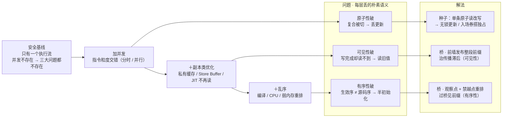

# T-Derivation-01

> **T-Derivation 系列** · 第一性推导笔记：不借用已有知识/术语，从"为什么会有问题"一直推到底层，再设计解法；名词一律自造，不与课本对名（对名留到学工具时再做）。
> 源问题：并发三大问题（可见性 / 原子性 / 有序性）
> 状态：§0~§7 推导已走完；§8 为工程层未决（留待学工具时对名）。

---

## 0 · 方法

- 从根源找"能动的一环"：能动的只有"在个别点上把被打破的语义买回来"；全局禁止是下策，局部补丁是上策。
- 每步问两件事：**恢复哪条语义？付多少代价？**

## 1 · 安全基线（真正的定义）

只有一个执行流访问内存。

副本、乱序、写缓冲在单执行流的机器上怎么折腾都不出错——**因为没有第二个执行流会读到**。所以基线安全的本质不是"内存很完美、按序执行"，而是"**并发不存在**"。

## 2 · 逐层离开基线：每加一种能力，丢一条朴素语义

一切问题的总前提 = **引入第二个执行流，且共享同一内存**。三大问题不是三个并列的 bug，而是逐层叠加的结果——每多一种能力，就多丢一条朴素语义。

**第 1 层 · 加并发**（任务在指令粒度交错：单核分时 / 多核并行）
内存仍是理想形态：单一副本、写即全局生效、按源码序执行。此时：
- 写即全局生效 → 无"已完成却看不见" → 可见性完好；
- 按源码序生效 → 读者看到的序 = 源码序 → 有序性完好；
- 复合操作（读-改-写）跨多条指令，并发允许在任意指令边界插入另一执行流 → 做到一半被打断 / 并行插入 → **原子性破**（丢更新）。

→ **并发单独就足以破坏原子性，不需要副本、不需要乱序。**

**第 2 层 · 加副本类优化**（私有缓存 / Store Buffer / JIT 读不再发起）
同一地址出现多个副本，写要排队发布。若保持按序（写缓冲先进先出），则写序不被颠倒：
- 读者可能读到滞后的旧值 → **可见性破**；
- 但相对顺序仍按源码（FIFO）→ 有序性仍完好。

→ 副本类优化单独造成传播滞后（可见性），不颠倒顺序。

**第 3 层 · 加乱序**（编译器 / CPU / 弱内存重排）
执行序 ≠ 源码序，读者观察到与源码不符的顺序（门开了、前面的货没到）→ **有序性破**。

**归总**

| 叠加的能力 | 丢的朴素语义 | 对应问题 |
|---|---|---|
| 并发（交错 / 并行） | 复合操作不可分割 | 原子性 |
| ＋副本类（缓存 / Store Buffer / JIT 不读） | 一次写对读者可见 | 可见性 |
| ＋乱序（编译 / CPU / 弱内存） | 生效顺序 = 源码序 | 有序性 |

（可见性、有序性都要"第二执行流去观察"才显性；原子性不需要观察，交错本身即破坏。）

## 3 · 三大问题

| 问题 | 断在哪 | 症状 |
|---|---|---|
| 可见性 | 写完成却传不到读者 | 读旧值，while 退不出 |
| 原子性 | 复合操作被交错切开 | 丢更新 |
| 有序性 | 读者观察到与发布不符的顺序 | 半初始化 |

## 4 · 解法总原则

- 打点，不全局。
- **声明即承诺**：没点名的访问无承诺、可随便优化；点名的交接访问才有语义。
- 不可分割的最小种子在硬件。
- **解法的分工照抄破的分层**：并发层破的（原子性）用种子/独占堵；副本、乱序层破的（可见性、有序性）用桥补。

## 5 · 桥：可见性 + 有序性共用

**标记变量**：挑出承担交接的访问，标记。

**发布点**（写方、写标记变量）＝ B 快照分界：
- 前墙：点之前（本线程前缀）的写不许拖到点后，到点整段带出；
- 后墙：点之后的写不许提前执行，不得偷渡进快照。

**观察点**（读方、读同一变量取到新值）：观察后的受保护读不许偷跑过点、必须真读。

发布点 + 观察点（**同一变量**）= 一座桥：过桥者见整份前缀、不见未到期的未来 → **完整快照**。有序性由此顺带解决。

这座桥同时补 §2 第 2、3 层的破：前墙把前缀写**强制发布**（治副本滞后＝可见性），发布时按序整段带出并禁止越点重排（治乱序＝有序性）。

**三条性质：**
1. guard 亮 ≠ 领到货：while 只决定何时过点；领什么由前墙内容决定（写方是谁、写了什么）。
2. 可见性单调：已定型的数据不再变，读者多看无害。所以桥只需防两件坏事——**前墙**防"门开了、该带的货没到"（半初始化），**后墙**防"不该来的未来货偷跑进来"（跨阶段泄漏）。单调正是"前墙带整段前缀也不怕带多"的理由。
3. 优化自由度分区：离点远随便动（真私有无害 / 未标记共享本无承诺）；点附近被墙钉住——这是 B 的固定税，**按点计费、不按变量计费**。

**取舍**：A 单向门（不管后写搭车，一面墙，便宜）vs **B 快照分界**（两面墙，贵）——已选 B。

## 6 · 桥的串联规则

- 同一线程多次发布：**前缀累积**（后一个点把前面全部再带一遍），迟到读者见完整历史。
- 跨线程：X 经桥领到 Y 已发布的写后，Y 的写排进 X 的前缀，随 X 之后的发布点一起带出（桥可跨线程接龙）。
- 多写方：(a) 各写各的 → 读者分别过点；(b) 需合并快照 / 争用同一变量 → 设**汇合点**协调者，catch up 所有写方后发合并点，读者只等一个点。

## 7 · 原子性

### 7.1 最小种子：硬件单条原子读改写

根：复合操作跨多条指令，指令之间可被交错切开。消缝 = 把"读 → 改 → 写"压成对**单个位置**的一次不可分割操作。

- **为什么必须来自硬件**：我们写的任何代码都是多条指令，指令边界就是可切入处；只有硬件能把"读-改-写"封成一条，指令内部不可切。
- **单核特例**：禁调度/关中断即可让一段代码不被切（内核做短临界区）；但只对一个核有效，多核下别的核照跑——通用解必须让硬件有这颗种子。
- **硬件实现方向**（设计层）：锁缓存行（只冻结该行，局部、便宜）或锁总线（冻结所有核对该内存的访问，全局、贵）；细节留到实现层。
- **边界**：种子只作用于"单位置、单字"。跨多位置/多变量的不变式无法用单条种子表达 → 见 7.2 路线 B。

### 7.2 种子的两种面孔 + 两条大规则

种子有两种操作形态：
- **直接改**（原子加 / 原子交换等）：一步完成"改"，适合语义本身是单步的操作；
- **带条件改**（比较-交换）：仅当位置当前值 == 期望值时写入新值，否则失败并告知当前值。价值：把"读"与"写"用期望值**绑成一步**——期间若被别人动过，操作整体失败。这是它能消掉"先读后写"那条缝的关键。

**路线 A：直接消缝（无锁更新）**
- 适用：单变量 + 简单更新（计数、翻转、标志）。
- 语义确定（如直接 +1）→ 用"直接改"一条搞定；
- 需要"先读当前值再决定写什么"（通用读-改-写）→ 用"带条件改"循环：读期望值 → 尝试 → 失败说明别人已改 → 重读 → 再试 → …每次成功都基于最新值。
- 代价：失败者自旋/重试，争用高时空转；只适用于单变量；无排队、无阻塞。

**路线 B：做入场券，搭独占（锁）**
- 适用：多变量 / 跨多步的不变式（改两个指针、余额与账本同更）——这种复合压不成单条种子。
- 机制：进场抢票（把"空闲"原子改成"占用"），仅成功者进入；执行临界区多步；出场还票（写回空闲）。
- **为什么必须原子抢票**：检查 + 标记分两步会让两人同时成功（前面已证）——抢票本身即一次原子读改写 → 独占长在种子上。
- 独占 = "更大粒度的原子"：不是把多步变一步，而是让整段期间别人进不来。
- 代价：失败者等待（自旋或挂起）；需排队与公平，否则饿死；临界区长则排队者积累。

**选择判据**：要原子的是单变量简单更新 → 路线 A；是跨多步/多变量的不变式 → 路线 B。

### 7.3 独占天然带桥

临界区被串行化后，若要后进入者看到前一人临界区内的写，进出场两端必须承担发布/观察语义：
- **出场 = 发布点**：把临界区内写的整段前缀带出；
- **进场 = 观察点**：过点后可见前一人的整段前缀。

所以锁 = **原子性种子（串行化）+ 桥（进出场的发布/观察）**——两颗种子并用，这也是它能同时覆盖可见性与有序性的原因。

### 7.4 与桥的分工

| 要守的语义 | 靠什么 |
|---|---|
| 一个位置"这一步"不可分割 | 原子读改写种子 |
| 一个线程的整段前缀对另一线程可见且有序 | 桥（发布点 / 观察点） |
| 多步不变式整体不被插入 + 前人的写对后人可见 | 独占（入场券种子 + 进出场桥） |

无锁桥（发布引用 → 读不可变对象）只用桥不用种子。单位置原子更新只用种子——该位置的结果经一致性对本位置自然可见，无需桥；**但更新一旦要与其它位置排序、或要充当交接点，就必须再叠桥**（现实中"原子类"因此把它做成 volatile：种子与桥绑在一起给）。

## 8 · 未决（工程层，留待学工具时对名）

- 独占的排队与公平（先来先服务、防饿死）、阻塞 vs 自旋的代价细分。
- 多写方汇合点的代价与并发度。
- 把整套推导映射回要学的工具（对名阶段，刻意后置以免污染推导）。

## 9 · 设计理念（贯穿全程的结论）

一句话：**默认放开，例外收紧；每条限制按"代价最小、语义恰好够"挑位置与强度。**

- 机器默认不限制（并发 + 副本/乱序都留着）；限制是被"买回来"的——只在会破坏语义的点上临时收回语义。所以解法是**打点**，不是"给整个世界加锁"。
- 每条限制按"最便宜够用"那档挑。税种从轻到重：**屏障（点）→ 按变量 → 原子指令（单位置）→ 独占（段）→ 汇合点（全局单写方）**。能按点付就不按变量付，能无锁就不上锁。
- 反向：有时故意用**超必要的强限制**（B / 全屏障）——买的是推理与规范的简单。所以精确说法不是"限制越少越好"，是"**在正确性、性能、推理成本之间按需定价**"：多数取最小必要，偶尔超买求少想。
- 规范面是同一枚硬币的另一面：默认给**最强的顺序一致**，只在程序出现数据竞争时才撤销承诺。实现放开是为了快；规范只在竞争处撒手，是为了让"写对的程序"永远保持直觉。
- 收口：每个机制都只回答一个问题——**它在压缩哪个代价、守住哪个正确性**。

---

## 10 · 全链流程图（安全基线 → 逐层破 → 解法）

> P2、P3 指向的是**同一座桥**：前墙治传播滞后（可见性），观察点 + 禁越点重排治乱序（有序性）。
